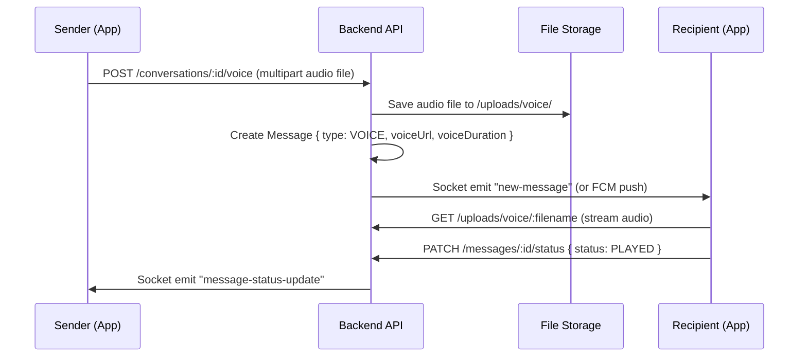
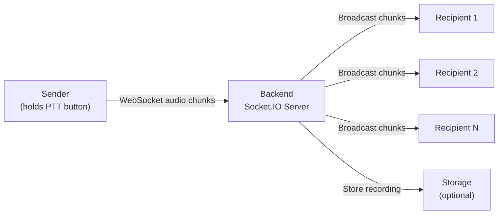
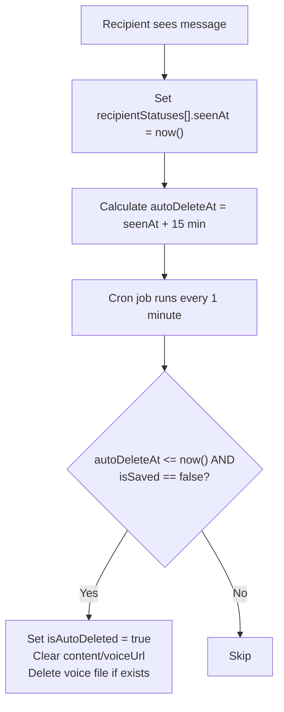

# 🚀 Arangtik – Frequent Connect: Implementation Plan

> A complete phase-by-phase blueprint to build the Frequent Connect communication feature within the existing Arangtik Node.js + Express + MongoDB backend and its React Native mobile app.

---

## 📂 Folder Structure (New Modules)

All new backend code lives inside the existing `Backend/src/modules/` convention. A new `frequentConnect/` module is introduced with sub-modules.

```
Backend/src/
├── modules/
│   └── frequentConnect/               ← NEW top-level module
│       ├── cluster/                   ← Cluster (group) management
│       │   ├── cluster.model.js
│       │   ├── cluster.controller.js
│       │   ├── cluster.service.js
│       │   ├── cluster.validation.js
│       │   └── cluster.routes.js
│       │
│       ├── member/                    ← Cluster membership & invitations
│       │   ├── member.model.js
│       │   ├── member.controller.js
│       │   ├── member.service.js
│       │   ├── member.validation.js
│       │   └── member.routes.js
│       │
│       ├── message/                   ← Text, voice & walkie-talkie messages
│       │   ├── message.model.js
│       │   ├── message.controller.js
│       │   ├── message.service.js
│       │   ├── message.validation.js
│       │   └── message.routes.js
│       │
│       ├── conversation/              ← Conversations (1:1 direct + cluster)
│       │   ├── conversation.model.js
│       │   ├── conversation.controller.js
│       │   ├── conversation.service.js
│       │   └── conversation.routes.js
│       │
│       ├── walkieTalkie/              ← Live push-to-talk sessions
│       │   ├── walkieTalkie.model.js
│       │   ├── walkieTalkie.service.js
│       │   └── walkieTalkie.gateway.js   ← Socket.IO event handlers
│       │
│       ├── invite/                    ← SMS/link invitations for non-users
│       │   ├── invite.model.js
│       │   ├── invite.service.js
│       │   ├── invite.controller.js
│       │   └── invite.routes.js
│       │
│       ├── savedMessage/              ← Saved / bookmarked messages
│       │   ├── savedMessage.model.js
│       │   ├── savedMessage.service.js
│       │   ├── savedMessage.controller.js
│       │   └── savedMessage.routes.js
│       │
│       ├── frequentConnect.routes.js   ← Aggregated route mounter
│       └── frequentConnect.socket.js   ← Central Socket.IO initializer
│
├── config/
│   └── socket.config.js               ← NEW – Socket.IO server config
│
├── middlewares/
│   └── socketAuth.middleware.js        ← NEW – JWT auth for WS connections
│
└── utils/
    └── messageAutoDelete.cron.js       ← NEW – 15-min auto-delete scheduler
```

---

## 🏗️ Phase-by-Phase Implementation

---

### Phase 1 — Foundation: Cluster CRUD & Membership

**Goal:** Users can create, edit, reorder, and delete Clusters. They can add/remove members by phone number.

**Duration:** ~1.5 weeks

#### 1.1 Data Models

##### `cluster.model.js`
```
Cluster {
  _id           : ObjectId
  name          : String (required, e.g. "Family", "Office")
  icon          : String (emoji or icon-id, optional)
  color         : String (hex, optional)
  creatorId     : ObjectId → User (required)
  type          : Enum ["FAMILY", "FRIENDS", "OFFICE", "CUSTOM"]
  isDefault     : Boolean (false) – preset clusters
  priority      : Number (0 = highest, used for ordering)
  memberCount   : Number (denormalized for fast reads)
  createdAt     : Date
  updatedAt     : Date
}
Indexes: { creatorId: 1, priority: 1 }
```

##### `member.model.js`
```
ClusterMember {
  _id           : ObjectId
  clusterId     : ObjectId → Cluster (required)
  userId        : ObjectId → User (nullable – null until invitation accepted)
  phone         : String (required – lookup key)
  displayName   : String (user-assigned alias)
  role          : Enum ["ADMIN", "MEMBER"] (default MEMBER)
  status        : Enum ["ACTIVE", "INVITED", "LEFT", "REMOVED"]
  joinedAt      : Date
  invitedAt     : Date
  createdAt     : Date
  updatedAt     : Date
}
Indexes: { clusterId: 1, userId: 1 }, { phone: 1 }
```

##### `invite.model.js`
```
Invite {
  _id           : ObjectId
  inviterId     : ObjectId → User
  inviteePhone  : String (required)
  clusterId     : ObjectId → Cluster
  status        : Enum ["PENDING", "ACCEPTED", "EXPIRED"]
  inviteCode    : String (unique short code for deep-link)
  expiresAt     : Date
  createdAt     : Date
}
Index: { inviteePhone: 1, status: 1 }
```

#### 1.2 API Endpoints

| Method | Endpoint | Description |
|--------|----------|-------------|
| `POST` | `/api/fc/clusters` | Create a new cluster |
| `GET` | `/api/fc/clusters` | Get all clusters for auth user (sorted by priority) |
| `GET` | `/api/fc/clusters/:id` | Get single cluster details |
| `PUT` | `/api/fc/clusters/:id` | Update cluster name/icon/color |
| `DELETE` | `/api/fc/clusters/:id` | Delete cluster (admin only) |
| `PATCH` | `/api/fc/clusters/reorder` | Reorder cluster priorities |
| `POST` | `/api/fc/clusters/:id/members` | Add member(s) by phone number |
| `GET` | `/api/fc/clusters/:id/members` | List cluster members |
| `DELETE` | `/api/fc/clusters/:id/members/:memberId` | Remove a member |
| `POST` | `/api/fc/invites` | Send invite SMS to non-Arangtik user |
| `POST` | `/api/fc/invites/:code/accept` | Accept invite by deep-link code |

#### 1.3 Key Business Logic

- **Add member by phone:** Look up `User` by phone → if found, create `ClusterMember` with `status: ACTIVE`; if not found, create with `status: INVITED` + send SMS invite via existing `sms.service.js`.
- **Priority reorder:** Accept `[ { clusterId, priority } ]` array and bulk-update in one transaction.
- **Invite acceptance:** On new user registration (in existing `auth.service.js verifyOtp`), check `Invite` collection → auto-join matching clusters.

#### 1.4 Tasks Checklist

- [ ] Create `cluster.model.js`, `cluster.validation.js`
- [ ] Create `cluster.service.js` with CRUD + reorder logic
- [ ] Create `cluster.controller.js` + `cluster.routes.js`
- [ ] Create `member.model.js`, `member.service.js`, `member.controller.js`, `member.routes.js`
- [ ] Create `invite.model.js`, `invite.service.js`, `invite.controller.js`, `invite.routes.js`
- [ ] Wire into `frequentConnect.routes.js` → mount in `routes/index.js` as `/api/fc`
- [ ] Hook invite-accept into `auth.service.js → verifyOtp()` post-registration
- [ ] Write unit tests for cluster CRUD & member addition
- [ ] Test with Postman / REST client

---

### Phase 2 — Conversations & Text Messaging (REST)

**Goal:** Users can start direct (1:1) or cluster-based conversations and send/receive text messages via REST API.

**Duration:** ~1.5 weeks

#### 2.1 Data Models

##### `conversation.model.js`
```
Conversation {
  _id             : ObjectId
  type            : Enum ["DIRECT", "CLUSTER"]
  clusterId       : ObjectId → Cluster (for CLUSTER type)
  participants    : [ObjectId → User]
  lastMessage     : {
    content       : String
    senderId      : ObjectId
    type          : String
    sentAt        : Date
  }
  createdAt       : Date
  updatedAt       : Date
}
Indexes: { participants: 1 }, { clusterId: 1 }
```

##### `message.model.js`
```
Message {
  _id               : ObjectId
  conversationId    : ObjectId → Conversation (required)
  senderId          : ObjectId → User (required)
  type              : Enum ["TEXT", "VOICE", "WALKIE_TALKIE"]
  content           : String (text body, or empty for voice)
  voiceUrl          : String (path to stored audio file)
  voiceDuration     : Number (seconds)
  status            : Enum ["SENT", "DELIVERED", "SEEN", "PLAYED"]
  recipientStatuses : [{
    userId          : ObjectId → User
    status          : Enum ["SENT", "DELIVERED", "SEEN", "PLAYED"]
    statusAt        : Date
    seenAt          : Date          ← triggers 15-min auto-delete timer
    isAutoDeleted   : Boolean (false)
    isSaved         : Boolean (false)
  }]
  isAutoDeleted     : Boolean (false)  ← global flag
  autoDeleteAt      : Date (null)      ← calculated: latest seenAt + 15 min
  createdAt         : Date
  updatedAt         : Date
}
Indexes: { conversationId: 1, createdAt: -1 }, { autoDeleteAt: 1, isAutoDeleted: 1 }
```

#### 2.2 API Endpoints

| Method | Endpoint | Description |
|--------|----------|-------------|
| `POST` | `/api/fc/conversations` | Start a direct conversation (body: `{ participantId }`) |
| `GET` | `/api/fc/conversations` | List all conversations for auth user |
| `GET` | `/api/fc/conversations/:id` | Get conversation with recent messages |
| `POST` | `/api/fc/conversations/:id/messages` | Send a text message |
| `GET` | `/api/fc/conversations/:id/messages` | Get paginated message history |
| `PATCH` | `/api/fc/messages/:id/status` | Update message status (delivered/seen/played) |

#### 2.3 Key Business Logic

- **Conversation dedup:** For `DIRECT` type, enforce uniqueness on sorted participant pair.
- **Cluster conversation:** Auto-created when cluster is created; `participants` mirrors cluster members.
- **Message status tracking:** Per-recipient status array. Status transitions: `SENT → DELIVERED → SEEN → PLAYED` (PLAYED only for voice).
- **Pagination:** Cursor-based using `createdAt` for infinite scroll.

#### 2.4 Tasks Checklist

- [ ] Create `conversation.model.js`, `conversation.service.js`, `conversation.controller.js`, `conversation.routes.js`
- [ ] Create `message.model.js`, `message.validation.js`
- [ ] Create `message.service.js` with send, list, status-update logic
- [ ] Create `message.controller.js`, `message.routes.js`
- [ ] Auto-create cluster conversations on cluster creation (hook in cluster.service)
- [ ] Add participant sync when cluster members change
- [ ] Write integration tests

---

### Phase 3 — Real-Time: Socket.IO & Push Notifications

**Goal:** Messages are delivered in real-time via WebSockets. Offline users receive FCM push notifications.

**Duration:** ~2 weeks

#### 3.1 Socket.IO Setup

##### `config/socket.config.js`
```js
// Initialize Socket.IO server attached to the HTTP server
// Namespace: /fc
// Auth: JWT token in handshake auth header
// Rooms: conversation:<conversationId> per active conversation
```

##### `middlewares/socketAuth.middleware.js`
```js
// Verify JWT from socket handshake → attach user to socket
// Reject unauthenticated connections
```

##### `frequentConnect.socket.js`
```js
// Central socket event registration:
// - connection / disconnect
// - join-conversation / leave-conversation
// - send-message → broadcast to conversation room
// - typing / stop-typing
// - message-status-update (delivered/seen)
// - online-status tracking
```

#### 3.2 Socket Events

| Event (Client → Server) | Payload | Description |
|--------------------------|---------|-------------|
| `join-conversation` | `{ conversationId }` | Join a conversation room |
| `leave-conversation` | `{ conversationId }` | Leave a conversation room |
| `send-message` | `{ conversationId, type, content }` | Send message via socket |
| `typing` | `{ conversationId }` | User is typing indicator |
| `message-status` | `{ messageId, status }` | Mark delivered/seen/played |

| Event (Server → Client) | Payload | Description |
|--------------------------|---------|-------------|
| `new-message` | `Message` object | New message broadcast |
| `message-status-update` | `{ messageId, recipientStatuses }` | Status change broadcast |
| `user-typing` | `{ conversationId, userId }` | Typing indicator |
| `user-online` / `user-offline` | `{ userId }` | Presence status |

#### 3.3 FCM Push Notifications

Leverage the existing `notification.service.js` and Firebase config:

- When a message is sent and the recipient is **not connected** via Socket.IO → send FCM push
- Notification types to add to `notification.model.js`:
  - `FC_NEW_MESSAGE`
  - `FC_VOICE_MESSAGE`
  - `FC_WALKIE_TALKIE_REQUEST`
  - `FC_CLUSTER_INVITATION`
  - `FC_MEMBER_ADDED`

#### 3.4 Integration with `server.js`

```js
// In server.js, after app.listen():
const { createServer } = require('http');
const httpServer = createServer(app);
const initSocket = require('./modules/frequentConnect/frequentConnect.socket');
initSocket(httpServer);
httpServer.listen(PORT, ...);
```

#### 3.5 Tasks Checklist

- [ ] Install `socket.io` dependency
- [ ] Create `config/socket.config.js`
- [ ] Create `middlewares/socketAuth.middleware.js`
- [ ] Create `frequentConnect.socket.js` – event registration
- [ ] Modify `server.js` to use HTTP server + Socket.IO
- [ ] Implement real-time message broadcasting
- [ ] Implement typing indicators & online presence
- [ ] Integrate FCM fallback for offline users
- [ ] Add new notification types to existing notification model
- [ ] Load test with multiple concurrent WebSocket clients

---

### Phase 4 — Voice Messages

**Goal:** Users can record and send voice messages. Recipients can play them. Status tracks `PLAYED`.

**Duration:** ~1 week

#### 4.1 Voice Message Flow



#### 4.2 API Endpoints

| Method | Endpoint | Description |
|--------|----------|-------------|
| `POST` | `/api/fc/conversations/:id/voice` | Upload & send voice message (multipart) |
| `GET` | `/api/uploads/voice/:filename` | Stream/download voice file |

#### 4.3 Key Details

- Use existing `multer` upload middleware; configure destination → `uploads/voice/`
- Audio format: accept `audio/aac`, `audio/mp4`, `audio/ogg`, `audio/webm`
- Max file size: 5MB (~3 minutes of compressed audio)
- Store `voiceDuration` from client metadata or parse server-side
- Voice files are subject to the same 15-minute auto-delete logic (file is deleted from disk too)

#### 4.4 Tasks Checklist

- [ ] Configure multer for voice uploads (`uploads/voice/`)
- [ ] Add voice upload endpoint to `message.controller.js`
- [ ] Add `PLAYED` status transition logic
- [ ] Serve voice files via static route or stream endpoint
- [ ] Add voice file cleanup to auto-delete cron (Phase 6)
- [ ] Test voice upload/playback end-to-end

---

### Phase 5 — Walkie-Talkie (Live Push-to-Talk)

**Goal:** Press-and-hold to speak live to a group or direct contact. Real-time audio streaming.

**Duration:** ~2.5 weeks

> [!IMPORTANT]
> This is the most technically complex phase. It requires real-time audio streaming, which is fundamentally different from REST APIs.

#### 5.1 Architecture



**Approach:** WebSocket-based audio streaming via Socket.IO binary events. No WebRTC required for half-duplex PTT.

#### 5.2 Socket Events

| Event | Direction | Payload | Description |
|-------|-----------|---------|-------------|
| `walkie-start` | Client → Server | `{ conversationId }` | User presses PTT button |
| `walkie-audio` | Client → Server | `{ conversationId, chunk: Buffer }` | Audio data chunk (binary) |
| `walkie-stop` | Client → Server | `{ conversationId }` | User releases PTT button |
| `walkie-incoming` | Server → Clients | `{ conversationId, speakerId, speakerName }` | Someone is speaking |
| `walkie-audio-stream` | Server → Clients | `{ conversationId, chunk: Buffer }` | Audio chunk broadcast |
| `walkie-ended` | Server → Clients | `{ conversationId, speakerId }` | Speaker finished |

#### 5.3 Data Model

##### `walkieTalkie.model.js`
```
WalkieTalkieSession {
  _id               : ObjectId
  conversationId    : ObjectId → Conversation
  speakerId         : ObjectId → User
  status            : Enum ["ACTIVE", "ENDED"]
  startedAt         : Date
  endedAt           : Date
  duration          : Number (seconds)
  recordingUrl      : String (optional – saved recording)
  createdAt         : Date
}
```

#### 5.4 Business Rules

- **Half-duplex:** Only one person can speak at a time per conversation. Server enforces floor control.
- **Floor request:** If someone is already speaking, new `walkie-start` events are queued or rejected with a `walkie-busy` event.
- **Auto-timeout:** If speaker doesn't send `walkie-stop` within 60 seconds, server auto-ends.
- **Recording:** Optionally concatenate audio chunks server-side and save as a voice message for offline members.

#### 5.5 Tasks Checklist

- [ ] Create `walkieTalkie.model.js`
- [ ] Create `walkieTalkie.service.js` – session management, floor control
- [ ] Create `walkieTalkie.gateway.js` – Socket.IO event handlers
- [ ] Register walkie-talkie events in `frequentConnect.socket.js`
- [ ] Implement audio chunk relay (binary frames via Socket.IO)
- [ ] Implement floor control (one speaker at a time)
- [ ] Implement auto-timeout (60s max speak time)
- [ ] Optional: Server-side recording concatenation
- [ ] Send FCM push for walkie-talkie requests to offline users
- [ ] Stress test with concurrent audio streams

---

### Phase 6 — 15-Minute Auto-Delete & Saved Messages

**Goal:** Messages auto-disappear 15 minutes after each individual recipient sees them. Users can save important messages to exempt them.

**Duration:** ~1 week

#### 6.1 Auto-Delete Mechanism



##### `utils/messageAutoDelete.cron.js`
```js
// Runs every 60 seconds via setInterval or node-cron
// Query: Messages where recipientStatuses contains entries with
//   seenAt + 15min <= now AND isAutoDeleted != true AND isSaved != true
// Action: Per-recipient: set isAutoDeleted = true
//   When ALL recipients are auto-deleted → scrub message content
```

> [!NOTE]
> Auto-delete is **per-recipient**. Each person's 15-minute timer starts independently when THEY see the message. The message content is scrubbed from DB only when ALL recipients' copies are deleted (or saved).

#### 6.2 Saved Messages

##### `savedMessage.model.js`
```
SavedMessage {
  _id           : ObjectId
  userId        : ObjectId → User (required)
  messageId     : ObjectId → Message (required)
  conversationId: ObjectId → Conversation
  savedAt       : Date
  note          : String (optional user note/tag)
}
Indexes: { userId: 1, savedAt: -1 }, { userId: 1, messageId: 1 } (unique)
```

#### 6.3 API Endpoints

| Method | Endpoint | Description |
|--------|----------|-------------|
| `POST` | `/api/fc/messages/:id/save` | Save a message (exempt from auto-delete) |
| `DELETE` | `/api/fc/messages/:id/save` | Unsave a message |
| `GET` | `/api/fc/saved-messages` | List all saved messages for auth user |

#### 6.4 Tasks Checklist

- [ ] Create `messageAutoDelete.cron.js` – scheduled cleanup job
- [ ] Integrate cron startup in `server.js`
- [ ] Implement per-recipient auto-delete logic
- [ ] Delete voice files from disk when messages are scrubbed
- [ ] Create `savedMessage.model.js`, service, controller, routes
- [ ] Mark `isSaved = true` in `recipientStatuses` when message is saved
- [ ] Saved messages skip auto-delete
- [ ] Write tests for auto-delete timing edge cases

---

### Phase 7 — Notifications & Widget Support

**Goal:** Full notification system for FC events. Prepare data APIs for app widgets.

**Duration:** ~1 week

#### 7.1 Notification Types

Add to existing `notification.model.js` enum:

```js
// Extend the 'type' enum:
'FC_NEW_TEXT_MESSAGE',
'FC_NEW_VOICE_MESSAGE',
'FC_WALKIE_TALKIE_REQUEST',
'FC_CLUSTER_INVITATION',
'FC_MEMBER_JOINED',
'FC_MEMBER_LEFT',
'FC_MESSAGE_STATUS'      // optional: delivery/read receipts
```

#### 7.2 Widget Data API

| Method | Endpoint | Description |
|--------|----------|-------------|
| `GET` | `/api/fc/widget/clusters` | Lightweight cluster list for home screen widget |
| `GET` | `/api/fc/widget/recent` | Recent conversations with unread counts |

Response format optimized for minimal payload:
```json
{
  "clusters": [
    { "id": "...", "name": "Family", "icon": "👨‍👩‍👧", "unreadCount": 3, "priority": 0 },
    { "id": "...", "name": "Office", "icon": "💼", "unreadCount": 0, "priority": 1 }
  ]
}
```

#### 7.3 Tasks Checklist

- [ ] Extend notification model with FC types
- [ ] Create notification triggers in message/cluster services
- [ ] Create widget data endpoints (lightweight, cached)
- [ ] Add unread message count tracking per conversation per user
- [ ] Test FCM delivery for all notification types
- [ ] Document push notification payload formats for mobile team

---

### Phase 8 — Chat History & Search

**Goal:** Persistent chat history with search. Message archive accessible even after auto-delete (for saved messages).

**Duration:** ~1 week

#### 8.1 API Endpoints

| Method | Endpoint | Description |
|--------|----------|-------------|
| `GET` | `/api/fc/conversations/:id/history` | Full paginated chat history |
| `GET` | `/api/fc/search/messages` | Search messages by text across all conversations |
| `GET` | `/api/fc/search/conversations` | Search conversations by name/member |

#### 8.2 Key Details

- **History:** Returns messages including auto-deleted ones (shown as "This message was deleted" placeholder for non-saved).
- **Search:** Text index on `Message.content` field. Only searches non-deleted messages and user's own saved messages.
- **Pagination:** Cursor-based with `before`/`after` timestamps.

#### 8.3 Tasks Checklist

- [ ] Add text index to `Message.content`
- [ ] Implement history endpoint with deleted-message placeholders
- [ ] Implement cross-conversation message search
- [ ] Implement conversation search
- [ ] Add pagination utilities (cursor-based)
- [ ] Performance test with large message volumes

---

### Phase 9 — Security, Performance & Polish

**Goal:** Harden the system, optimize performance, add rate limiting, and finalize.

**Duration:** ~1.5 weeks

#### 9.1 Security

- [ ] **Rate limiting** on message sending (e.g., max 30 messages/min per user)
- [ ] **Input sanitization** – sanitize all text message content (XSS prevention)
- [ ] **File validation** – strict MIME type checking for voice uploads
- [ ] **Socket connection limits** – max 5 concurrent socket connections per user
- [ ] **Cluster size limits** – max 50 members per cluster
- [ ] **Message size limits** – max 5000 chars for text, 5MB for voice

#### 9.2 Performance

- [ ] **Redis caching** for online presence and typing indicators (optional, can use in-memory Map initially)
- [ ] **Database indexes** – verify all query patterns have proper indexes
- [ ] **Connection pooling** – ensure MongoDB connection pool is sized for Socket.IO concurrency
- [ ] **Message batching** – batch status updates to reduce DB writes
- [ ] **Audio chunk compression** – ensure client sends compressed audio (Opus/AAC)

#### 9.3 Monitoring

- [ ] Add logging for socket connection/disconnection events
- [ ] Add metrics for message throughput, active connections
- [ ] Add error tracking for failed message deliveries
- [ ] Health check endpoint for Socket.IO server

---

## 📊 Complete API Route Map

All Frequent Connect routes mount under `/api/fc`:

```
/api/fc
├── /clusters
│   ├── GET        → List user's clusters (sorted by priority)
│   ├── POST       → Create cluster
│   ├── PATCH /reorder → Reorder priorities
│   └── /:id
│       ├── GET    → Cluster details
│       ├── PUT    → Update cluster
│       ├── DELETE → Delete cluster
│       └── /members
│           ├── GET    → List members
│           ├── POST   → Add member(s)
│           └── /:memberId
│               └── DELETE → Remove member
│
├── /conversations
│   ├── GET        → List conversations
│   ├── POST       → Start direct conversation
│   └── /:id
│       ├── GET       → Conversation details + messages
│       ├── /messages
│       │   ├── GET   → Paginated messages
│       │   └── POST  → Send text message
│       ├── /voice
│       │   └── POST  → Send voice message (multipart)
│       └── /history
│           └── GET   → Full chat history
│
├── /messages
│   └── /:id
│       ├── PATCH /status → Update message status
│       ├── POST /save    → Save message
│       └── DELETE /save  → Unsave message
│
├── /invites
│   ├── POST              → Send invite
│   └── /:code/accept     → Accept invite
│
├── /saved-messages
│   └── GET               → List saved messages
│
├── /search
│   ├── /messages          → Search messages
│   └── /conversations     → Search conversations
│
└── /widget
    ├── /clusters          → Widget cluster data
    └── /recent            → Widget recent conversations
```

---

## 🔗 Integration Points with Existing Codebase

| Existing Module | Integration |
|----------------|-------------|
| [user.model.js](file:///d:/My Codes/Arangtik/Backend/src/modules/auth/user.model.js) | Lookup users by phone for member addition |
| [auth.service.js](file:///d:/My Codes/Arangtik/Backend/src/modules/auth/auth.service.js#L228-L270) | Hook into `verifyOtp()` to auto-accept pending invites on registration |
| [auth.middleware.js](file:///d:/My Codes/Arangtik/Backend/src/middlewares/auth.middleware.js) | Reuse `protect` middleware for all FC routes |
| [notification.model.js](file:///d:/My Codes/Arangtik/Backend/src/modules/notification/notification.model.js) | Extend notification types for FC events |
| [notification.service.js](file:///d:/My Codes/Arangtik/Backend/src/modules/notification/notification.service.js) | Reuse FCM push delivery for offline message notifications |
| [sms.service.js](file:///d:/My Codes/Arangtik/Backend/src/utils/sms.service.js) | Send SMS invites to non-Arangtik users |
| [upload.middleware.js](file:///d:/My Codes/Arangtik/Backend/src/middlewares/upload.middleware.js) | Extend multer config for voice file uploads |
| [routes/index.js](file:///d:/My Codes/Arangtik/Backend/src/routes/index.js) | Mount FC routes: `router.use('/fc', frequentConnectRoutes)` |
| [server.js](file:///d:/My Codes/Arangtik/Backend/src/server.js) | Upgrade to HTTP server + Socket.IO initialization |
| [env.config.js](file:///d:/My Codes/Arangtik/Backend/src/config/env.config.js) | Add FC-specific env vars (auto-delete TTL, max cluster size, etc.) |

---

## 📦 New Dependencies

| Package | Purpose | Phase |
|---------|---------|-------|
| `socket.io` | WebSocket server for real-time messaging | Phase 3 |
| `node-cron` | Scheduled auto-delete job | Phase 6 |

> [!TIP]
> The project already uses Express, Mongoose, JWT, Firebase Admin, and Multer — no additional heavy dependencies are needed beyond Socket.IO.

---

## 📅 Timeline Summary

| Phase | Feature | Est. Duration |
|-------|---------|---------------|
| **1** | Cluster CRUD & Membership | 1.5 weeks |
| **2** | Conversations & Text Messaging (REST) | 1.5 weeks |
| **3** | Real-Time Socket.IO & Push Notifications | 2 weeks |
| **4** | Voice Messages | 1 week |
| **5** | Walkie-Talkie (Live PTT) | 2.5 weeks |
| **6** | Auto-Delete & Saved Messages | 1 week |
| **7** | Notifications & Widget Support | 1 week |
| **8** | Chat History & Search | 1 week |
| **9** | Security, Performance & Polish | 1.5 weeks |
| | **Total** | **~13 weeks** |

> [!CAUTION]
> Phase 5 (Walkie-Talkie) is the highest-risk phase due to real-time audio streaming complexity. Consider building a proof-of-concept first before committing to the full implementation. It may also require infrastructure considerations (bandwidth, server resources) for production scale.

---

## ✅ Definition of Done (per phase)

Each phase is considered complete when:
1. All models are created and tested
2. All API endpoints are functional and return correct responses
3. Business logic edge cases are handled
4. Integration with existing modules is verified
5. Postman/REST collection is updated
6. Unit/integration tests pass
7. Code reviewed and merged
