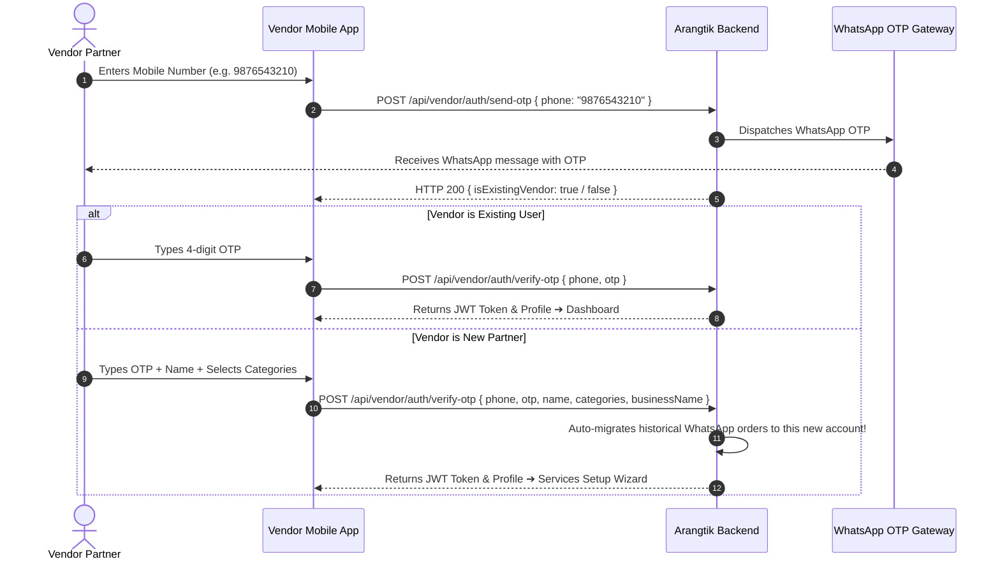

# 🧺 Arangtik Vendor App — Complete Partner API Integration Guide

> **Official Partner & Vendor Mobile Application API Contract & Integration Manual**  
> **Target Audience:** Flutter, React Native, Native Android (Kotlin), and iOS (Swift) Engineers  
> **Backend Base URL:** `http://localhost:8083/api/vendor` *(or `/api/v1/vendor`)*  
> **Production Base URL:** `https://api.arangtik.com/api/vendor`  
> **API Version:** `v1.2.0`  
> **Authentication:** `Bearer JWT Token` (Header: `Authorization: Bearer <VENDOR_TOKEN>`, Claim: `role: "vendor"`)  
> **Global Response Standard:** `{ "success": boolean, "statusCode": number, "message": string, "data": { ... } }`

---

## 📑 Series-Wise Table of Contents (Vendor Partner Journey)

1. [🌐 Series 0: Global Architecture, Environments & Vendor Auth Standards](#-series-0-global-architecture-environments--vendor-auth-standards)
2. [🏷️ Series 1: Trade Category & Service Catalog Discovery (Public)](#-series-1-trade-category--service-catalog-discovery-public)
3. [🔐 Series 2: Vendor Authentication & Onboarding Lifecycle](#-series-2-vendor-authentication--onboarding-lifecycle)
4. [👤 Series 3: Vendor Profile & Multi-Trade Categories Configuration](#-series-3-vendor-profile--multi-trade-categories-configuration)
5. [💰 Series 4: Service Offerings & Custom Rate Card Configuration](#-series-4-service-offerings--custom-rate-card-configuration)
6. [📋 Series 5: Vendor Work Orders Management (Vendor Hub)](#-series-5-vendor-work-orders-management-vendor-hub)
7. [⚙️ Series 6: Critical Business Rules, Role Separation & State Sync](#-series-6-critical-business-rules-role-separation--state-sync)
8. [🔔 Series 7: Push Notifications (FCM) & Events for Vendor App](#-series-7-push-notifications-fcm--events-for-vendor-app)
9. [🖼️ Series 8: Image & Media URL Resolution Protocol](#-series-8-image--media-url-resolution-protocol)
10. [🚀 Series 9: Ready-to-Use Vendor Mobile Integration Client (Flutter & React Native)](#-series-9-ready-to-use-vendor-mobile-integration-client-flutter--react-native)
11. [🎨 Series 10: Vendor UI/UX Status Badges & Color Palette Guide](#-series-10-vendor-uiux-status-badges--color-palette-guide)

---

## 🌐 Series 0: Global Architecture, Environments & Vendor Auth Standards

### 1. Base URLs & Network Endpoints

| Environment | Base URL | Media Uploads URL | Target Platform |
|---|---|---|---|
| **Localhost (Dev)** | `http://localhost:8083/api/vendor` | `http://localhost:8083` | Web / Node server |
| **Android Emulator** | `http://10.0.2.2:8083/api/vendor` | `http://10.0.2.2:8083` | Android Studio AVD |
| **Physical Device (Wi-Fi)** | `http://192.168.x.x:8083/api/vendor` | `http://192.168.x.x:8083` | Replace with your computer's local LAN IP |
| **Production Cloud** | `https://api.arangtik.com/api/vendor` | `https://api.arangtik.com` | Production SSL CDN |

### 2. Standard HTTP Headers

```http
Content-Type: application/json
Accept: application/json
Authorization: Bearer <VENDOR_JWT_TOKEN>
```

### 3. Vendor Token Security
Protected vendor routes enforce the `protectVendor` middleware. The verified JWT contains:
```json
{
  "id": "6ad4a204850e8a45c0ac41d2",
  "vendorId": "VND-773717",
  "phone": "918949056321",
  "role": "vendor",
  "category": "Washerman"
}
```

### 4. Global API Envelope
```json
// HTTP 200 / 201 Success Response
{
  "success": true,
  "statusCode": 200,
  "message": "Action completed successfully",
  "data": { ... }
}

// HTTP 400 / 401 / 403 / 404 / 500 Error Response
{
  "success": false,
  "statusCode": 400,
  "message": "Descriptive reason for failure",
  "errors": []
}
```

---

## 🏷️ Series 1: Trade Category & Service Catalog Discovery (Public)

**Zero Hardcoding Guarantee:** Categories (e.g. *Washerman*, *Doodh Wala*, *Tailor*) and their services/rates are 100% dynamic from MongoDB.

---

### 1.1 List Available Vendor Service Categories
Fetches all trade categories so the vendor app can render category selection pills during registration or settings.

- **Method:** `GET`
- **Path:** `/api/vendor/categories` *(aliases: `/api/vendor/auth/categories`, `/api/categories`)*
- **Auth Required:** `No (Public)`

#### Success Response (`200 OK`)
```json
{
  "success": true,
  "statusCode": 200,
  "message": "Vendor categories retrieved successfully",
  "data": [
    {
      "_id": "6ad35971b52d7dd7d79f7035",
      "name": "Washerman",
      "code": "WASHERMAN",
      "icon": "🧺",
      "description": "Laundry, Dry Cleaning & Garment Care",
      "imageUrl": "http://localhost:8083/uploads/category_washerman.png",
      "sortOrder": 1,
      "services": [
        {
          "_id": "6ad89efdcb41a2627aecb421",
          "name": "dry",
          "code": "DRY",
          "price": 0,
          "sortOrder": 1,
          "isActive": true
        },
        {
          "_id": "6ad9a687e02e82bf9aaf7444",
          "name": "iron and press",
          "code": "IRON_AND_PRESS",
          "price": 0,
          "sortOrder": 2,
          "isActive": true
        }
      ]
    },
    {
      "_id": "6ad35971b52d7dd7d79f7038",
      "name": "Doodh Wala",
      "code": "DOODH_WALA",
      "icon": "🥛",
      "description": "Fresh Milk & Dairy Delivery",
      "imageUrl": "http://localhost:8083/uploads/category_dairy.png",
      "sortOrder": 2,
      "services": []
    }
  ]
}
```

---

### 1.2 List Available Services for a Category
When a vendor selects their category, fetch all standard services under that category so the vendor can choose what they offer and set custom rates.

- **Method:** `GET`
- **Path:** `/api/vendor/categories/:category/services`
- **Auth Required:** `No (Public)`
- **Example:** `GET /api/vendor/categories/Washerman/services`

#### Success Response (`200 OK`)
```json
{
  "success": true,
  "statusCode": 200,
  "message": "Category services retrieved successfully",
  "data": [
    {
      "_id": "6ad89efdcb41a2627aecb421",
      "name": "dry",
      "code": "DRY",
      "description": "Chemical dry wash for delicate clothes",
      "icon": "🧼",
      "price": 0,
      "isActive": true,
      "categoryId": "6ad35971b52d7dd7d79f7035",
      "categoryName": "Washerman"
    },
    {
      "_id": "6ad9a687e02e82bf9aaf7444",
      "name": "iron and press",
      "code": "IRON_AND_PRESS",
      "description": "High temperature wrinkle press",
      "icon": "👔",
      "price": 0,
      "isActive": true,
      "categoryId": "6ad35971b52d7dd7d79f7035",
      "categoryName": "Washerman"
    }
  ]
}
```

---

### 1.3 Check Vendor by Phone (Lookup)
- **Method:** `GET`
- **Path:** `/api/vendor/lookup?phone=9876543210`
- **Auth Required:** `Yes (Bearer Token)`

#### Success Response (Registered Vendor)
```json
{
  "success": true,
  "statusCode": 200,
  "message": "Registered vendor found",
  "data": {
    "isRegistered": true,
    "vendor": {
      "id": "6ad4a204850e8a45c0ac41d2",
      "vendorId": "VND-773717",
      "name": "Ramu Dhobi",
      "businessName": "CleanWash Express",
      "phone": "919876543210",
      "category": "Washerman",
      "rating": 4.9,
      "isVerified": true,
      "services": [ ... ]
    }
  }
}
```

---

## 🔐 Series 2: Vendor Authentication & Onboarding Lifecycle

Arangtik Vendor App uses **passwordless WhatsApp OTP authentication**. Vendors can log in in seconds using just their mobile number.



---

### 2.1 Send WhatsApp OTP
- **Method:** `POST`
- **Path:** `/api/vendor/auth/send-otp`
- **Auth Required:** `No (Public)`
- **Content-Type:** `application/json`

#### Request Body
```json
{
  "phone": "9876543210"
}
```

#### Success Response (`200 OK`)
```json
{
  "success": true,
  "statusCode": 200,
  "message": "OTP sent successfully to your WhatsApp number",
  "data": {
    "phone": "919876543210",
    "isExistingVendor": true,
    "expiresInMinutes": 5
  }
}
```

---

### 2.2 Verify WhatsApp OTP (Instant Passwordless Login)
- **Method:** `POST`
- **Path:** `/api/vendor/auth/verify-otp`
- **Auth Required:** `No (Public)`
- **Content-Type:** `application/json`

#### Request Body (Existing Vendor)
```json
{
  "phone": "9876543210",
  "otp": "1234"
}
```

#### Success Response (`200 OK`)
```json
{
  "success": true,
  "statusCode": 200,
  "message": "Vendor login successful",
  "data": {
    "token": "eyJhbGciOiJIUzI1NiIsInR5cCI6IkpXVCJ9...",
    "isNewVendor": false,
    "vendor": {
      "_id": "6ad4a204850e8a45c0ac41d2",
      "vendorId": "VND-773717",
      "name": "Ramu Dhobi",
      "phone": "919876543210",
      "category": "Washerman",
      "primaryCategory": "Washerman",
      "categories": ["Washerman"],
      "businessName": "CleanWash Express",
      "rating": 5.0,
      "totalOrdersHandled": 12,
      "isVerified": true,
      "status": "ACTIVE"
    }
  }
}
```

---

### 2.3 New Vendor Registration (with Category & Shop Details)
If `isExistingVendor === false`, provide the vendor's name and trade categories along with the OTP:

- **Method:** `POST`
- **Path:** `/api/vendor/auth/verify-otp` *(alias: `/api/vendor/auth/register`)*
- **Auth Required:** `No (Public)`
- **Content-Type:** `application/json`

#### Request Body
```json
{
  "phone": "9876543210",
  "otp": "1234",
  "name": "Ramu Sharma",
  "category": "Washerman",
  "categories": ["Washerman"],
  "primaryCategory": "Washerman",
  "businessName": "CleanWash Express",
  "address": {
    "street": "Shop 4, Market Complex",
    "city": "Jaipur",
    "state": "Rajasthan",
    "pincode": "302001"
  }
}
```

#### Success Response (`201 Created` or `200 OK`)
```json
{
  "success": true,
  "statusCode": 200,
  "message": "Vendor registered and logged in successfully",
  "data": {
    "token": "eyJhbGciOiJIUzI1NiIsInR5cCI6IkpXVCJ9...",
    "isNewVendor": true,
    "vendor": {
      "_id": "6ad4a204850e8a45c0ac41d2",
      "vendorId": "VND-773717",
      "name": "Ramu Sharma",
      "phone": "919876543210",
      "category": "Washerman",
      "primaryCategory": "Washerman",
      "categories": ["Washerman"],
      "businessName": "CleanWash Express",
      "rating": 5.0,
      "totalOrdersHandled": 0,
      "isVerified": true,
      "status": "ACTIVE",
      "createdAt": "2026-02-18T10:00:00.000Z"
    }
  }
}
```
> **Seamless Migration Note:** If any customers had previously sent WhatsApp work orders to this phone number while it was unregistered, the backend **automatically claims and attaches those past work orders** to this vendor's newly created account!

---

### 2.4 Quick QA / Testing Credentials (Bypass OTP)
For Apple App Store review, Google Play QA, and local testing:
- **Test Mobile Number:** `918949056321` *(or any number ending with `8949056321`)*
- **Fixed Bypass OTP:** `1234`

---

## 👤 Series 3: Vendor Profile & Multi-Trade Categories Configuration

A partner can operate in multiple trades (e.g. *Washerman* + *Tailor*).

---

### 3.1 Get Authenticated Vendor Profile
- **Method:** `GET`
- **Path:** `/api/vendor/profile` *(alias: `/api/vendor/auth/me`)*
- **Auth Required:** `Yes (Bearer <VENDOR_TOKEN>)`

#### Success Response (`200 OK`)
```json
{
  "success": true,
  "statusCode": 200,
  "message": "Vendor profile fetched successfully",
  "data": {
    "_id": "6ad4a204850e8a45c0ac41d2",
    "vendorId": "VND-773717",
    "name": "Ramu Sharma",
    "phone": "919876543210",
    "category": "Washerman",
    "primaryCategory": "Washerman",
    "categories": ["Washerman"],
    "businessName": "CleanWash Express",
    "address": {
      "street": "Shop 4, Market Complex",
      "city": "Jaipur",
      "state": "Rajasthan",
      "pincode": "302001"
    },
    "rating": 5.0,
    "totalOrdersHandled": 14,
    "isVerified": true,
    "services": [ ... ],
    "offeredServices": ["dry", "iron and press"]
  }
}
```

---

### 3.2 Update Profile & Shop Details (STRICT: PATCH ONLY)
- **Method:** `PATCH`
- **Path:** `/api/vendor/profile`
- **Auth Required:** `Yes (Bearer <VENDOR_TOKEN>)`
- **Content-Type:** `application/json`

#### Request Body
```json
{
  "name": "Ramu Sharma",
  "businessName": "CleanWash Hub & Laundry Pro",
  "address": {
    "street": "Shop 4, Main Market Road",
    "city": "Jaipur",
    "state": "Rajasthan",
    "pincode": "302001"
  }
}
```

#### Success Response (`200 OK`)
```json
{
  "success": true,
  "statusCode": 200,
  "message": "Vendor profile updated successfully",
  "data": {
    "_id": "6ad4a204850e8a45c0ac41d2",
    "businessName": "CleanWash Hub & Laundry Pro"
  }
}
```

---

### 3.3 Multi-Category Selection & Primary Trade
Enables the vendor to operate across multiple trade pipelines (e.g. Receive orders for both *Washerman* and *Tailor*).

- **Method:** `PATCH`
- **Path:** `/api/vendor/categories`
- **Auth Required:** `Yes (Bearer <VENDOR_TOKEN>)`
- **Content-Type:** `application/json`

#### Request Body
```json
{
  "categories": ["Washerman", "Tailor"],
  "primaryCategory": "Washerman"
}
```

#### Success Response (`200 OK`)
```json
{
  "success": true,
  "statusCode": 200,
  "message": "Vendor categories updated successfully",
  "data": {
    "_id": "6ad4a204850e8a45c0ac41d2",
    "primaryCategory": "Washerman",
    "categories": ["Washerman", "Tailor"]
  }
}
```

---

## 💰 Series 4: Service Offerings & Custom Rate Card Configuration

Vendors decide which services they offer and set their own custom prices per garment.

---

### 4.1 Get Vendor Configured Services & Rates
- **Method:** `GET`
- **Path:** `/api/vendor/services`
- **Auth Required:** `Yes (Bearer <VENDOR_TOKEN>)`

#### Success Response (`200 OK`)
```json
{
  "success": true,
  "statusCode": 200,
  "message": "Vendor services fetched successfully",
  "data": {
    "vendorId": "6ad4a204850e8a45c0ac41d2",
    "category": "Washerman",
    "services": [
      {
        "serviceId": "6ad89efdcb41a2627aecb421",
        "name": "dry",
        "code": "DRY",
        "price": 40,
        "isOffered": true
      },
      {
        "serviceId": "6ad9a687e02e82bf9aaf7444",
        "name": "iron and press",
        "code": "IRON_AND_PRESS",
        "price": 20,
        "isOffered": true
      }
    ],
    "offeredServices": ["dry", "iron and press"]
  }
}
```

---

### 4.2 Configure Offered Services & Set Custom Rates
The vendor ticks which services they offer and sets their price per garment.

- **Method:** `PATCH`
- **Path:** `/api/vendor/services`
- **Auth Required:** `Yes (Bearer <VENDOR_TOKEN>)`
- **Content-Type:** `application/json`

#### Request Body
```json
{
  "services": [
    {
      "serviceId": "6ad89efdcb41a2627aecb421",
      "name": "dry",
      "code": "DRY",
      "price": 40,
      "isOffered": true
    },
    {
      "serviceId": "6ad9a687e02e82bf9aaf7444",
      "name": "iron and press",
      "code": "IRON_AND_PRESS",
      "price": 20,
      "isOffered": true
    },
    {
      "serviceId": "6ad9a697e02e82bf9aaf7466",
      "name": "premium cleaning",
      "code": "PREMIUM_CLEANING",
      "price": 80,
      "isOffered": false
    }
  ]
}
```

#### Success Response (`200 OK`)
```json
{
  "success": true,
  "statusCode": 200,
  "message": "Vendor services updated successfully",
  "data": {
    "vendorId": "VND-773717",
    "services": [
      { "name": "dry", "price": 40, "isOffered": true },
      { "name": "iron and press", "price": 20, "isOffered": true }
    ],
    "offeredServices": ["dry", "iron and press"]
  }
}
```

---

## 📋 Series 5: Vendor Work Orders Management (Vendor Hub)

The primary operational hub for partners to accept, manage, and progress customer orders.

---

### 5.1 List Assigned Work Orders (with Category Filtering)
- **Method:** `GET`
- **Path:** `/api/vendor/orders`
- **Auth Required:** `Yes (Bearer <VENDOR_TOKEN>)`

#### Query Parameters
| Parameter | Type | Required | Description |
|---|---|---|---|
| `category` | String | No | Filter by active trade tab (e.g. `Washerman`, `Tailor`, or `ALL`) |
| `status` | String | No | Filter by status (`ALL`, `PENDING_PICKUP`, `PICKED_UP`, `IN_PROCESS`, `READY_FOR_DELIVERY`, `DELIVERED`, `REJECTED`, `CANCELLED`) |
| `search` | String | No | Search by order number (`ORD-2026-0042`), customer name, or customer phone |
| `page` | Integer | No | Page number (Default: `1`) |
| `limit` | Integer | No | Page limit (Default: `20`) |

#### Success Response (`200 OK`)
```json
{
  "success": true,
  "statusCode": 200,
  "message": "Vendor work orders retrieved successfully",
  "data": {
    "orders": [
      {
        "_id": "67c3344556677889900aabbc",
        "orderNumber": "ORD-2026-0042",
        "orderCategory": "Washerman",
        "userName": "Rahul Sharma",
        "userPhone": "919876543210",
        "totalItems": 3,
        "totalCost": 80,
        "status": "PENDING_PICKUP",
        "pickupDate": "2026-02-19T09:00:00.000Z",
        "expectedDeliveryDate": "2026-02-21T18:00:00.000Z",
        "specialInstructions": "Please handle silk suit gently",
        "pdfUrl": "http://localhost:8083/uploads/order_ORD-2026-0042.pdf",
        "createdAt": "2026-02-18T17:30:00.000Z"
      }
    ],
    "pagination": { "total": 1, "page": 1, "limit": 20, "pages": 1 }
  }
}
```

---

### 5.2 Get Work Order Details
- **Method:** `GET`
- **Path:** `/api/vendor/orders/:id`
- **Auth Required:** `Yes (Bearer <VENDOR_TOKEN>)`

#### Success Response (`200 OK`)
```json
{
  "success": true,
  "statusCode": 200,
  "message": "Vendor work order details retrieved",
  "data": {
    "_id": "67c3344556677889900aabbc",
    "orderNumber": "ORD-2026-0042",
    "orderCategory": "Washerman",
    "userName": "Rahul Sharma",
    "userPhone": "919876543210",
    "status": "PENDING_PICKUP",
    "totalItems": 3,
    "totalCost": 80,
    "pickupDate": "2026-02-19T09:00:00.000Z",
    "expectedDeliveryDate": "2026-02-21T18:00:00.000Z",
    "specialInstructions": "Please handle silk suit gently",
    "pdfUrl": "http://localhost:8083/uploads/order_ORD-2026-0042.pdf",
    "items": [
      {
        "wardrobeItemId": "67b12345abcdef0123456789",
        "name": "Navy Blue Linen Shirt",
        "category": "UPPER_WEAR",
        "serviceType": "IRON",
        "serviceName": "iron and press",
        "price": 20,
        "specialInstructions": "Starch the collar firmly",
        "imageUrl": "http://localhost:8083/uploads/garment_987654.png"
      },
      {
        "wardrobeItemId": "67c11223344556677889900a",
        "name": "Silk Party Kurta",
        "category": "UPPER_WEAR",
        "serviceType": "DRY_CLEAN",
        "serviceName": "dry",
        "price": 40,
        "specialInstructions": "Delicate silk dry cleaning",
        "imageUrl": "http://localhost:8083/uploads/garment_112233.png"
      }
    ],
    "statusHistory": [
      {
        "status": "PENDING_PICKUP",
        "changedBy": "USER",
        "changedAt": "2026-02-18T17:30:00.000Z",
        "note": "Work order created by customer"
      }
    ]
  }
}
```

---

### 5.3 Update Work Order Status (STRICT: PATCH ONLY)
Progress the order through its lifecycle.

- **Method:** `PATCH`
- **Path:** `/api/vendor/orders/:id/status`
- **Auth Required:** `Yes (Bearer <VENDOR_TOKEN>)`
- **Content-Type:** `application/json`

#### Allowed Status Transitions for Vendors:
- `PICKED_UP`: Garments collected from customer home.
- `IN_PROCESS`: Washing / Ironing / Dry Cleaning underway.
- `READY_FOR_DELIVERY`: Processed, packed, and ready to return.
- `DELIVERED`: Delivered back to customer (Marks order complete).
- `REJECTED`: Vendor declines or rejects the order (Mandatory note).
- ❌ **`CANCELLED` IS STRICTLY PROHIBITED FOR VENDORS** *(Only customers can cancel)*.

#### Request Body
```json
{
  "status": "IN_PROCESS",
  "note": "Garments have been washed, ironing underway"
}
```

#### Success Response (`200 OK`)
```json
{
  "success": true,
  "statusCode": 200,
  "message": "Work order status updated successfully by vendor",
  "data": {
    "_id": "67c3344556677889900aabbc",
    "orderNumber": "ORD-2026-0042",
    "status": "IN_PROCESS"
  }
}
```

---

## ⚙️ Series 6: Critical Business Rules, Role Separation & State Sync

### 1. Progressive Lifecycle Diagram

```
[ Step 1: PENDING_PICKUP ] ──► [ Step 2: PICKED_UP ] ──► [ Step 3: IN_PROCESS ] ──► [ Step 4: READY_FOR_DELIVERY ] ──► [ Step 5: DELIVERED (Complete) ]
         │                                                                                                                      │
         ├─── Vendor Rejection: REJECTED (with reason) ────────────────────────────────────────────────────────────────────────┤
         │                                                                                                                      ▼
         └─── Customer Cancellation: CANCELLED ───────────────────────────────────────► All garments automatically revert to status: ACTIVE
```

### 2. Role Separation & Terminal Rules
- **Customer Only:** `CANCELLED` (Customer can cancel if vendor hasn't picked up).
- **Vendor Only:** `REJECTED` (Vendor can decline if shop is overloaded or address out of range).
- **Garment Auto-Sync:** When an order reaches `DELIVERED`, `REJECTED`, or `CANCELLED`, all wardrobe clothes in that order automatically revert from `INACTIVE` back to `ACTIVE` in the customer's Almari.
- **Instant Customer Push Notifications:** When a vendor updates status (`PICKED_UP`, `IN_PROCESS`, `DELIVERED`), the backend dispatches an instant FCM push notification to the customer's phone!

---

## 🔔 Series 7: Push Notifications (FCM) & Events for Vendor App

The vendor app should handle incoming push notifications to notify the vendor in real-time:

| Event / `data.type` | Trigger | Recommended Action in Vendor App |
|---|---|---|
| `LAUNDRY_ORDER_NEW` | Customer placed a new work order for this vendor | Play notification alert sound & open Work Order Detail screen |
| `LAUNDRY_ORDER_CANCELLED` | Customer cancelled an order before pickup | Show toast & mark order as cancelled in list |
| `VENDOR_ACTIVATED` | Admin approved vendor profile or verification | Display verification badge on profile |

---

## 🖼️ Series 8: Image & Media URL Resolution Protocol

The backend returns garment photos and PDF slips as relative or absolute URLs.

### Flutter / Dart Utility:
```dart
String resolveMediaUrl(String? path, {String baseUrl = 'http://localhost:8083'}) {
  if (path == null || path.isEmpty) return '';
  if (path.startsWith('http://') || path.startsWith('https://')) {
    if (Platform.isAndroid && path.contains('localhost')) {
      return path.replaceAll('localhost', '10.0.2.2');
    }
    return path;
  }
  final cleanBase = baseUrl.replaceAll(RegExp(r'/api/?$'), '');
  final cleanPath = path.startsWith('/') ? path : '/$path';
  return '$cleanBase$cleanPath';
}
```

---

## 🚀 Series 9: Ready-to-Use Vendor Mobile Integration Client

### Flutter / Dart Implementation (`dio`)

```dart
import 'dart:io';
import 'package:dio/dio.dart';
import 'package:flutter_secure_storage/flutter_secure_storage.dart';

class ArangtikVendorClient {
  static final String baseUrl = Platform.isAndroid 
      ? 'http://10.0.2.2:8083/api/vendor' 
      : 'http://localhost:8083/api/vendor';

  final Dio _dio = Dio(BaseOptions(
    baseUrl: baseUrl,
    connectTimeout: const Duration(seconds: 15),
    receiveTimeout: const Duration(seconds: 30),
  ));

  final FlutterSecureStorage _storage = const FlutterSecureStorage();

  ArangtikVendorClient() {
    _dio.interceptors.add(InterceptorsWrapper(
      onRequest: (options, handler) async {
        final token = await _storage.read(key: 'vendor_jwt_token');
        if (token != null) {
          options.headers['Authorization'] = 'Bearer $token';
        }
        return handler.next(options);
      },
      onError: (DioException error, handler) async {
        if (error.response?.statusCode == 401) {
          await _storage.delete(key: 'vendor_jwt_token');
        }
        return handler.next(error);
      },
    ));
  }

  // 1. Send WhatsApp OTP
  Future<Map<String, dynamic>> sendOtp(String phone) async {
    final res = await _dio.post('/auth/send-otp', data: {'phone': phone});
    return res.data;
  }

  // 2. Verify OTP & Login
  Future<Map<String, dynamic>> verifyOtp(String phone, String otp) async {
    final res = await _dio.post('/auth/verify-otp', data: {'phone': phone, 'otp': otp});
    final token = res.data['data']['token'];
    await _storage.write(key: 'vendor_jwt_token', value: token);
    return res.data;
  }

  // 3. Register New Vendor
  Future<Map<String, dynamic>> registerVendor(Map<String, dynamic> payload) async {
    final res = await _dio.post('/auth/verify-otp', data: payload);
    final token = res.data['data']['token'];
    await _storage.write(key: 'vendor_jwt_token', value: token);
    return res.data;
  }

  // 4. Get Assigned Work Orders
  Future<Map<String, dynamic>> getOrders({String? category, String? status}) async {
    final res = await _dio.get('/orders', queryParameters: {
      if (category != null && category != 'ALL') 'category': category,
      if (status != null && status != 'ALL') 'status': status,
    });
    return res.data;
  }

  // 5. Update Work Order Status
  Future<Map<String, dynamic>> updateStatus(String orderId, String newStatus, {String? note}) async {
    final res = await _dio.patch('/orders/$orderId/status', data: {
      'status': newStatus,
      if (note != null) 'note': note,
    });
    return res.data;
  }

  // 6. Update Services & Rates
  Future<Map<String, dynamic>> updateServices(List<Map<String, dynamic>> services) async {
    final res = await _dio.patch('/services', data: {'services': services});
    return res.data;
  }
}
```

---

### React Native / TypeScript Implementation (`axios`)

```typescript
import axios from 'axios';
import * as SecureStore from 'expo-secure-store';
import { Platform } from 'react-native';

const BASE_URL = Platform.OS === 'android' 
  ? 'http://10.0.2.2:8083/api/vendor' 
  : 'http://localhost:8083/api/vendor';

export const vendorApi = axios.create({
  baseURL: BASE_URL,
  timeout: 30000,
});

vendorApi.interceptors.request.use(async (config) => {
  const token = await SecureStore.getItemAsync('vendor_jwt_token');
  if (token) {
    config.headers.Authorization = `Bearer ${token}`;
  }
  return config;
});

vendorApi.interceptors.response.use(
  (res) => res,
  async (err) => {
    if (err.response?.status === 401) {
      await SecureStore.deleteItemAsync('vendor_jwt_token');
    }
    return Promise.reject(err);
  }
);

// 1. Send OTP
export const sendVendorOtp = (phone: string) => 
  vendorApi.post('/auth/send-otp', { phone }).then(r => r.data);

// 2. Verify OTP Login
export const verifyVendorOtp = async (phone: string, otp: string) => {
  const res = await vendorApi.post('/auth/verify-otp', { phone, otp });
  await SecureStore.setItemAsync('vendor_jwt_token', res.data.data.token);
  return res.data;
};

// 3. Get Work Orders
export const getVendorOrders = (category?: string, status?: string) => 
  vendorApi.get('/orders', { params: { category, status } }).then(r => r.data);

// 4. Update Status
export const updateOrderStatus = (orderId: string, status: string, note?: string) => 
  vendorApi.patch(`/orders/${orderId}/status`, { status, note }).then(r => r.data);
```

---

## 🎨 Series 10: Vendor UI/UX Status Badges & Color Palette Guide

| Status Key | Vendor Display Label | Background | Text Color | Icon |
| :--- | :--- | :--- | :--- | :--- |
| `PENDING_PICKUP` | **Awaiting Pickup** | `#FEF3C7` (amber-100) | `#92400E` (amber-800) | 🕒 |
| `PICKED_UP` | **Garments Collected** | `#E0E7FF` (indigo-100) | `#3730A3` (indigo-800) | 🛵 |
| `IN_PROCESS` | **Washing / Ironing** | `#DBEAFE` (blue-100) | `#1E40AF` (blue-800) | 🧺 |
| `READY_FOR_DELIVERY` | **Ready for Delivery** | `#EDE9FE` (purple-100) | `#5B21B6` (purple-800) | 📦 |
| `DELIVERED` | **Delivered & Completed** | `#D1FAE5` (emerald-100) | `#065F46` (emerald-800) | ✅ |
| `REJECTED` | **Order Declined** | `#FFE4E6` (rose-100) | `#9F1239` (rose-800) | 🚫 |
| `CANCELLED` | **Cancelled by User** | `#F3F4F6` (slate-100) | `#374151` (slate-700) | ❌ |

---

> **Support:** Core Engineering Team, Arangtik Technologies.
