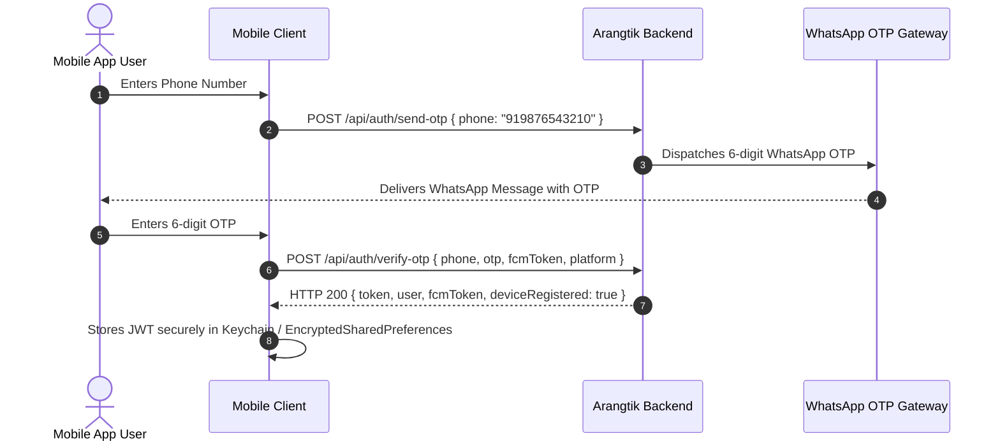
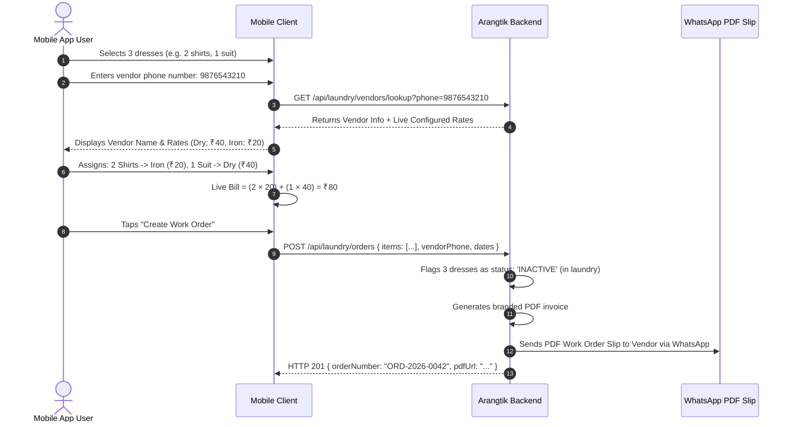

# 📱 Arangtik Mobile App — Complete User API Integration Guide

> **Official Mobile Application API Contract & Integration Manual**  
> **Target Audience:** Flutter, React Native, Native Android (Kotlin), and iOS (Swift) Engineers  
> **Backend Base URL:** `http://localhost:8083/api` *(Production: `https://api.arangtik.com/api`)*  
> **API Version:** `v1.2.0`  
> **Authentication:** `Bearer JWT Token` (Header: `Authorization: Bearer <TOKEN>`)  
> **Global Response Standard:** `{ "success": boolean, "statusCode": number, "message": string, "data": { ... } }`

---

## 📑 Series-Wise Table of Contents (User App Journey)

1. [🌐 Series 0: Global Architecture, Environments & Headers](#-series-0-global-architecture-environments--headers)
2. [🔐 Series 1: Authentication & Session Lifecycle](#-series-1-authentication--session-lifecycle)
3. [👤 Series 2: User Profile & Biometric Face Reference](#-series-2-user-profile--biometric-face-reference)
4. [🚪 Series 3: Digital Almari / Multi-Wardrobe Containers](#-series-3-digital-almari--multi-wardrobe-containers)
5. [📸 Series 4: Camera & Gallery Clothes Ingestion (AI Vision & Anti-Duplicate)](#-series-4-camera--gallery-clothes-ingestion-ai-vision--anti-duplicate)
6. [👥 Series 5: Event & Group Photo Biometric Filtering](#-series-5-event--group-photo-biometric-filtering)
7. [👗 Series 6: Wardrobe Catalog, Filtering, Search & Clothing Management](#-series-6-wardrobe-catalog-filtering-search--clothing-management)
8. [🧊 Series 7: 3D Garment Mesh Reconstruction (TripoSR Engine)](#-series-7-3d-garment-mesh-reconstruction-triposr-engine)
9. [✨ Series 8: Smart AI Outfit Recommendations & Styling](#-series-8-smart-ai-outfit-recommendations--styling)
10. [🏷️ Series 9: Service Categories & Live Rate Card Discovery](#-series-9-service-categories--live-rate-card-discovery)
11. [🧺 Series 10: Laundry & Service Work Orders (Customer Dispatch)](#-series-10-laundry--service-work-orders-customer-dispatch)
12. [🔔 Series 11: Push Notifications (FCM) & In-App Notification Inbox](#-series-11-push-notifications-fcm--in-app-notification-inbox)
13. [🖼️ Series 12: Image & Media URL Resolution Protocol](#-series-12-image--media-url-resolution-protocol)
14. [🚀 Series 13: Ready-to-Use Mobile Integration Client (Flutter & React Native)](#-series-13-ready-to-use-mobile-integration-client-flutter--react-native)

---

## 🌐 Series 0: Global Architecture, Environments & Headers

### 1. Base URLs & Network Endpoints

| Environment | Base URL | Media Uploads URL | Notes |
|---|---|---|---|
| **Localhost (Dev)** | `http://localhost:8083/api` | `http://localhost:8083` | Web / Node server |
| **Android Emulator** | `http://10.0.2.2:8083/api` | `http://10.0.2.2:8083` | Standard Android Studio AVD mapping |
| **Physical Device (Wi-Fi)** | `http://192.168.x.x:8083/api` | `http://192.168.x.x:8083` | Replace with your computer's local LAN IP |
| **Production Cloud** | `https://api.arangtik.com/api` | `https://api.arangtik.com` | SSL Enabled CDN |

### 2. Standard HTTP Headers

```http
Content-Type: application/json
Accept: application/json
Authorization: Bearer <JWT_TOKEN>
```
*Note: For endpoints that accept photos (`POST /api/wardrobe/add-item`, etc.), use `multipart/form-data` and do NOT manually specify `Content-Type: boundary=...` (let your HTTP client generate the multipart boundary automatically).*

### 3. Global Response Format

All responses follow a predictable envelope:

```json
// HTTP 200 / 201 Success Response
{
  "success": true,
  "statusCode": 200,
  "message": "Action completed successfully",
  "data": { ... }
}

// HTTP 400 / 401 / 403 / 404 / 409 / 500 Error Response
{
  "success": false,
  "statusCode": 400,
  "message": "Descriptive reason for failure",
  "errors": []
}
```

---

## 🔐 Series 1: Authentication & Session Lifecycle

Arangtik uses passwordless mobile authentication via a 6-digit WhatsApp OTP. The user enters their phone number, receives an OTP on WhatsApp, and upon verification receives a JWT token.



---

### 1.1 Send OTP
Dispatches a 6-digit verification code to the user's WhatsApp number.

- **Method:** `POST`
- **Path:** `/api/auth/send-otp`
- **Auth Required:** `No (Public)`
- **Content-Type:** `application/json`

#### Request Body
```json
{
  "phone": "919876543210"
}
```
*Validation:* Phone number must include country code (e.g. `91` for India) without `+` or spaces (10–14 digits).

#### Success Response (`200 OK`)
```json
{
  "success": true,
  "statusCode": 200,
  "message": "OTP sent successfully to your WhatsApp number",
  "data": {
    "phone": "919876543210",
    "otpExpirySeconds": 300
  }
}
```

---

### 1.2 Verify OTP & Login / Register
Verifies the 6-digit OTP, registers the user if new, associates the device's FCM push token, and returns the authentication token.

- **Method:** `POST`
- **Path:** `/api/auth/verify-otp`
- **Auth Required:** `No (Public)`
- **Content-Type:** `application/json`

#### Request Body
```json
{
  "phone": "919876543210",
  "otp": "123456",
  "name": "Rahul Sharma",
  "fcmToken": "dK_3f9z...fcm_registration_token...",
  "platform": "ANDROID",
  "deviceId": "unique_hardware_uuid",
  "deviceModel": "Google Pixel 8",
  "appVersion": "1.2.0"
}
```

#### Success Response (`200 OK`)
```json
{
  "success": true,
  "statusCode": 200,
  "message": "Login successful",
  "data": {
    "token": "eyJhbGciOiJIUzI1NiIsInR5cCI6IkpXVCJ9.eyJpZCI6IjY1ZjFh...",
    "user": {
      "_id": "67a3f890b1234567890abcdef",
      "phone": "919876543210",
      "name": "Rahul Sharma",
      "gender": "MALE",
      "profileImage": "http://localhost:8083/uploads/avatar_123.jpg",
      "hasReferenceFace": true,
      "defaultWardrobeId": "6ac8e4471dd51c1c79a52e6d"
    },
    "fcmToken": "dK_3f9z...",
    "deviceRegistered": true
  }
}
```

---

### 1.3 User Logout
Clears the session on the backend and permanently revokes the device FCM push token.

- **Method:** `POST`
- **Path:** `/api/auth/logout`
- **Auth Required:** `Yes (Bearer <TOKEN>)`
- **Content-Type:** `application/json`

#### Request Body (Optional)
```json
{
  "fcmToken": "dK_3f9z...fcm_registration_token..."
}
```
*Note: If `fcmToken` is passed, only that device's token is deleted. If omitted, all device tokens for this user session are revoked.*

#### Success Response (`200 OK`)
```json
{
  "success": true,
  "statusCode": 200,
  "message": "Logged out successfully"
}
```

---

## 👤 Series 2: User Profile & Biometric Face Reference

The user profile holds identity info and an optional enrolled reference face (powered by InsightFace) used to automatically detect the user in group and event photos.

---

### 2.1 Get Current User Profile
- **Method:** `GET`
- **Path:** `/api/auth/me` *(alias: `/api/auth/profile`)*
- **Auth Required:** `Yes (Bearer <TOKEN>)`

#### Success Response (`200 OK`)
```json
{
  "success": true,
  "statusCode": 200,
  "message": "Profile retrieved successfully",
  "data": {
    "user": {
      "_id": "67a3f890b1234567890abcdef",
      "phone": "919876543210",
      "name": "Rahul Sharma",
      "email": "rahul@example.com",
      "gender": "MALE",
      "profileImage": "http://localhost:8083/uploads/avatar_123.jpg",
      "hasReferenceFace": true,
      "defaultWardrobeId": "6ac8e4471dd51c1c79a52e6d",
      "createdAt": "2026-02-06T10:00:00.000Z"
    }
  }
}
```

---

### 2.2 Update Profile Attributes
- **Method:** `PATCH` *(Strict Arangtik Rule: never use PUT)*
- **Path:** `/api/auth/profile`
- **Auth Required:** `Yes (Bearer <TOKEN>)`
- **Content-Type:** `application/json` (or `multipart/form-data`)

#### Request Body
```json
{
  "name": "Rahul Sharma",
  "gender": "MALE",
  "email": "rahul.sharma@example.com"
}
```

#### Success Response (`200 OK`)
```json
{
  "success": true,
  "statusCode": 200,
  "message": "Profile updated successfully",
  "data": {
    "user": {
      "_id": "67a3f890b1234567890abcdef",
      "name": "Rahul Sharma",
      "gender": "MALE",
      "email": "rahul.sharma@example.com"
    }
  }
}
```

---

### 2.3 Upload Profile Image & Enroll Reference Face
Uploads a clear portrait/selfie. The backend automatically extracts and saves the 512-dimension face embedding for biometric clothing matching.

- **Method:** `POST`
- **Path:** `/api/auth/profile-image` *(alias: `POST /api/face-recognition/register`)*
- **Auth Required:** `Yes (Bearer <TOKEN>)`
- **Content-Type:** `multipart/form-data`

#### Multipart Form Fields
| Field Name | Type | Description |
|---|---|---|
| `image` *(or `photo`)* | Binary File | Front-facing portrait photo (JPEG / PNG, max 10MB) |

#### Success Response (`200 OK`)
```json
{
  "success": true,
  "statusCode": 200,
  "message": "Profile image uploaded and face enrolled successfully",
  "data": {
    "profileImage": "http://localhost:8083/uploads/img_928340.jpg",
    "faceEnrolled": true,
    "faceEmbeddingAvailable": true
  }
}
```

---

### 2.4 Check Reference Face Status
- **Method:** `GET`
- **Path:** `/api/face-recognition/status`
- **Auth Required:** `Yes (Bearer <TOKEN>)`

#### Success Response (`200 OK`)
```json
{
  "success": true,
  "statusCode": 200,
  "message": "Face reference status retrieved",
  "data": {
    "hasReferenceFace": true,
    "enrolledAt": "2026-02-06T10:15:30.000Z"
  }
}
```

---

### 2.5 Delete Reference Face
- **Method:** `DELETE`
- **Path:** `/api/face-recognition/reference`
- **Auth Required:** `Yes (Bearer <TOKEN>)`

#### Success Response (`200 OK`)
```json
{
  "success": true,
  "statusCode": 200,
  "message": "Reference face deleted successfully"
}
```

---

## 🚪 Series 3: Digital Almari / Multi-Wardrobe Containers

Users can manage multiple closets / almaris (e.g. *"My Wardrobe"*, *"Office Closet"*, *"Party Wear"*, *"Mummy's Almari"*).

---

### 3.1 List User Wardrobes
- **Method:** `GET`
- **Path:** `/api/wardrobe/get-wardrobes` *(alias: `/api/wardrobe/create-wardrobe`)*
- **Auth Required:** `Yes (Bearer <TOKEN>)`

#### Success Response (`200 OK`)
```json
{
  "success": true,
  "statusCode": 200,
  "message": "Wardrobes retrieved successfully",
  "data": [
    {
      "_id": "6ac8e4471dd51c1c79a52e6d",
      "name": "My Almari",
      "ownerName": "Rahul",
      "isDefault": true,
      "itemCount": 24,
      "createdAt": "2026-02-01T08:00:00.000Z"
    },
    {
      "_id": "6bc9f5582ee62d2d89b63f7e",
      "name": "Winter Collection",
      "ownerName": "Rahul",
      "isDefault": false,
      "itemCount": 8,
      "createdAt": "2026-02-15T12:00:00.000Z"
    }
  ]
}
```

---

### 3.2 Create New Wardrobe Container
- **Method:** `POST`
- **Path:** `/api/wardrobe/create-wardrobe`
- **Auth Required:** `Yes (Bearer <TOKEN>)`
- **Content-Type:** `multipart/form-data` or `application/json`

#### Form Fields / JSON Body
```json
{
  "name": "Office Formal Almari",
  "ownerName": "Rahul Sharma",
  "isDefault": false
}
```

#### Success Response (`201 Created`)
```json
{
  "success": true,
  "statusCode": 201,
  "message": "Wardrobe created successfully",
  "data": {
    "_id": "6cd0a6693ff73e3e90c74a8f",
    "name": "Office Formal Almari",
    "ownerName": "Rahul Sharma",
    "isDefault": false,
    "itemCount": 0
  }
}
```

---

## 📸 Series 4: Camera & Gallery Clothes Ingestion (AI Vision & Anti-Duplicate)

This is the primary feature of Arangtik. The user captures or selects a photo of a garment. The backend performs:
1. **Garment Detection & Background Removal** (Segmenting the clothes).
2. **Attribute Extraction** (Primary color, category, subcategory, pattern).
3. **Duplicate Prevention Check** (Comparing visual features and embeddings against existing clothes in the Almari).

```mermaid
graph TD
    A[User captures / selects garment photo] --> B[App calls POST /api/wardrobe/add-item]
    B --> C{AI Vision Engine: Check Duplicate}
    C -- "Similarity < 85%" --> D[Save New Garment Item in Almari]
    D --> E[Return duplicateDetected: false, item: { ... }]
    C -- "Similarity >= 85%" --> F[Flag as Duplicate]
    F --> G[Return duplicateDetected: true, similarityScore, existingItem: { ... }]
    G --> H{Mobile UI prompts User: 'Same or Different?'}
    H -- "It's a Different Dress" --> I[Call POST /api/wardrobe/add-item with forceAdd: true]
    I --> D
    H -- "It's the Same Dress" --> J[User Discards / Keeps Existing]
```

---

### 4.1 Extract & Add Item to Almari (Single Unified Action)
- **Method:** `POST`
- **Path:** `/api/wardrobe/add-item` *(aliases: `/api/wardrobe/extract-item`, `/api/wardrobe/items`)*
- **Auth Required:** `Yes (Bearer <TOKEN>)`
- **Content-Type:** `multipart/form-data`

#### Multipart Form Fields
| Field Name | Type | Required | Description |
|---|---|---|---|
| `photo` *(or `photos`, `image`, `file`)* | Binary File | Yes | Garment photograph from camera or gallery |
| `wardrobeId` | String | No | Target Almari ID (defaults to user's default Almari) |
| `forceAdd` | String / Bool | No | Set to `'true'` to force-save even if duplicate is flagged |
| `name` | String | No | Optional custom garment name |
| `category` | String | No | Optional override: `UPPER_WEAR`, `LOWER_WEAR`, `FULL_BODY`, `FOOTWEAR`, `ACCESSORIES` |

---

#### Response Scenario A: Unique Dress (Newly Added to Almari)
HTTP `201 Created` or `200 OK`:
```json
{
  "success": true,
  "statusCode": 201,
  "message": "Garment extracted and added to your Almari successfully",
  "data": {
    "duplicateDetected": false,
    "item": {
      "_id": "67b12345abcdef0123456789",
      "wardrobeId": "6ac8e4471dd51c1c79a52e6d",
      "name": "Navy Blue Linen Shirt",
      "category": "UPPER_WEAR",
      "subCategory": "SHIRT",
      "color": "Navy Blue",
      "season": "SUMMER",
      "occasion": "CASUAL",
      "status": "ACTIVE",
      "images": [
        {
          "url": "http://localhost:8083/uploads/garment_987654.png",
          "isPrimary": true
        }
      ],
      "wearCount": 0,
      "createdAt": "2026-02-18T14:20:00.000Z"
    }
  }
}
```

---

#### Response Scenario B: Duplicate Dress Flagged (Side-by-Side Comparison)
HTTP `200 OK`:
```json
{
  "success": true,
  "statusCode": 200,
  "message": "Potential duplicate garment detected in your Almari",
  "data": {
    "duplicateDetected": true,
    "similarityScore": 0.92,
    "uploadedImage": "http://localhost:8083/uploads/temp_scan_1122.png",
    "existingItem": {
      "_id": "65e99887766554433221100a",
      "name": "Dark Blue Casual Shirt",
      "category": "UPPER_WEAR",
      "subCategory": "SHIRT",
      "color": "Navy Blue",
      "status": "ACTIVE",
      "primaryImage": "http://localhost:8083/uploads/garment_443322.png",
      "wearCount": 4,
      "lastWorn": "2026-02-10T11:00:00.000Z"
    }
  }
}
```
> **Mobile Client Action:** Present a modal showing the newly captured photo next to `existingItem.primaryImage` with two options:
> - **"Yes, it's the same dress"** ➔ Close modal and discard.
> - **"No, this is a different dress"** ➔ Re-call `POST /api/wardrobe/add-item` with `forceAdd: 'true'` (or call with existing photo).

---

### 4.2 Bulk Ingestion (Multiple Gallery Photos)
Upload up to 100 photos at once (e.g. from a photoshoot or album).

- **Method:** `POST`
- **Path:** `/api/wardrobe/add-item` *(alias: `/api/wardrobe/bulk-add-photos`)*
- **Auth Required:** `Yes (Bearer <TOKEN>)`
- **Content-Type:** `multipart/form-data`

#### Multipart Form Fields
| Field Name | Type | Description |
|---|---|---|
| `photos` *(or `images`)* | Array of Files | Up to 100 images |
| `wardrobeId` | String | Target Almari ID |

#### Success Response (`200 OK`)
```json
{
  "success": true,
  "statusCode": 200,
  "message": "Processed 5 images: 4 items added, 1 duplicate flagged",
  "data": {
    "addedCount": 4,
    "duplicateCount": 1,
    "addedItems": [ ... ],
    "duplicates": [ ... ]
  }
}
```

---

## 👥 Series 5: Event & Group Photo Biometric Filtering

When a user selects group or event photos, the app can verify whether the user appears in each photo before extracting clothes.

---

### 5.1 Verify Face in Photo
- **Method:** `POST`
- **Path:** `/api/face-recognition/verify`
- **Auth Required:** `Yes (Bearer <TOKEN>)`
- **Content-Type:** `multipart/form-data`

#### Multipart Form Fields
| Field Name | Type | Description |
|---|---|---|
| `photo` *(or `image`)* | Binary File | Event / Group photograph |
| `threshold` | Number | Optional matching threshold (Default: `0.60`) |

#### Success Response (`200 OK`)
```json
{
  "success": true,
  "statusCode": 200,
  "message": "Face verification completed",
  "data": {
    "isUserPresent": true,
    "confidence": 0.89,
    "facesDetectedCount": 3,
    "userBbox": { "x": 120, "y": 80, "width": 140, "height": 180 }
  }
}
```

---

## 👗 Series 6: Wardrobe Catalog, Filtering, Search & Clothing Management

Browse, filter, search, view, edit (strictly `PATCH`), and delete clothes in the Almari.

---

### 6.1 List Clothes / Wardrobe Items (Catalog with Pagination)
- **Method:** `GET`
- **Path:** `/api/wardrobe/get-items` *(aliases: `/api/wardrobe/items`, `/api/wardrobe/get-all-items`)*
- **Auth Required:** `Yes (Bearer <TOKEN>)`

#### Query Parameters
| Parameter | Type | Required | Example | Description |
|---|---|---|---|---|
| `wardrobeId` | String | No | `6ac8e44...` | Filter by specific Almari |
| `category` | String | No | `UPPER_WEAR` | `UPPER_WEAR`, `LOWER_WEAR`, `FULL_BODY`, `FOOTWEAR`, `ACCESSORIES` |
| `subCategory` | String | No | `SHIRT` | `SHIRT`, `T_SHIRT`, `JEANS`, `TROUSERS`, `KURTA`, `SUIT`, `DRESS` |
| `status` | String | No | `ACTIVE` | `ACTIVE` (clean/ready) or `INACTIVE` (in laundry) |
| `color` | String | No | `Blue` | Color filter |
| `season` | String | No | `SUMMER` | `SUMMER`, `WINTER`, `ALL_SEASON`, `MONSOON` |
| `occasion` | String | No | `CASUAL` | `CASUAL`, `FORMAL`, `PARTY`, `ETHNIC`, `SPORTS` |
| `search` | String | No | `Linen` | Search query matching garment name or color |
| `page` | Integer | No | `1` | Page number (Default: `1`) |
| `limit` | Integer | No | `20` | Items per page (Default: `20`) |

#### Success Response (`200 OK`)
```json
{
  "success": true,
  "statusCode": 200,
  "message": "Wardrobe items retrieved successfully",
  "data": {
    "items": [
      {
        "_id": "67b12345abcdef0123456789",
        "name": "Navy Blue Linen Shirt",
        "category": "UPPER_WEAR",
        "subCategory": "SHIRT",
        "color": "Navy Blue",
        "season": "SUMMER",
        "occasion": "CASUAL",
        "status": "ACTIVE",
        "images": [
          { "url": "http://localhost:8083/uploads/garment_987654.png", "isPrimary": true }
        ],
        "model3d": {
          "status": "COMPLETED",
          "modelUrl": "http://localhost:8083/uploads/models/garment_987654.glb"
        },
        "wearCount": 3,
        "createdAt": "2026-02-18T14:20:00.000Z"
      }
    ],
    "pagination": {
      "total": 35,
      "page": 1,
      "limit": 20,
      "pages": 2
    }
  }
}
```

---

### 6.2 Get Single Garment Details
- **Method:** `GET`
- **Path:** `/api/wardrobe/get-item/:id` *(alias: `/api/wardrobe/items/:id`)*
- **Auth Required:** `Yes (Bearer <TOKEN>)`

#### Success Response (`200 OK`)
```json
{
  "success": true,
  "statusCode": 200,
  "message": "Item details retrieved",
  "data": {
    "item": {
      "_id": "67b12345abcdef0123456789",
      "name": "Navy Blue Linen Shirt",
      "category": "UPPER_WEAR",
      "subCategory": "SHIRT",
      "color": "Navy Blue",
      "season": "SUMMER",
      "occasion": "CASUAL",
      "status": "ACTIVE",
      "wearCount": 3,
      "images": [
        { "url": "http://localhost:8083/uploads/garment_987654.png", "isPrimary": true }
      ]
    }
  }
}
```

---

### 6.3 Update Garment Attributes (STRICT: PATCH ONLY)
- **Method:** `PATCH` *(Never use PUT)*
- **Path:** `/api/wardrobe/edit-item/:id` *(aliases: `/api/wardrobe/update-item/:id`, `/api/wardrobe/items/:id`)*
- **Auth Required:** `Yes (Bearer <TOKEN>)`
- **Content-Type:** `application/json`

#### Request Body (All fields optional)
```json
{
  "name": "Premium Italian Navy Shirt",
  "color": "Dark Navy",
  "season": "ALL_SEASON",
  "occasion": "FORMAL",
  "notes": "Dry clean only or delicate iron",
  "tags": ["favorite", "office", "summer"]
}
```

#### Success Response (`200 OK`)
```json
{
  "success": true,
  "statusCode": 200,
  "message": "Item updated successfully",
  "data": {
    "item": {
      "_id": "67b12345abcdef0123456789",
      "name": "Premium Italian Navy Shirt",
      "occasion": "FORMAL"
    }
  }
}
```

---

### 6.4 Delete Garment from Almari
- **Method:** `DELETE`
- **Path:** `/api/wardrobe/delete-item/:id` *(alias: `/api/wardrobe/items/:id`)*
- **Auth Required:** `Yes (Bearer <TOKEN>)`

#### Success Response (`200 OK`)
```json
{
  "success": true,
  "statusCode": 200,
  "message": "Clothing item deleted successfully"
}
```

---

## 🧊 Series 7: 3D Garment Mesh Reconstruction (TripoSR Engine)

Generates an interactive 3D `.glb` mesh for any garment using the TripoSR neural reconstruction engine.

---

### 7.1 Trigger 3D Model Generation
- **Method:** `POST`
- **Path:** `/api/wardrobe/generate-3d/:id` *(alias: `/api/wardrobe/items/:id/generate-3d`)*
- **Auth Required:** `Yes (Bearer <TOKEN>)`

#### Success Response (`200 OK`)
```json
{
  "success": true,
  "statusCode": 200,
  "message": "3D model generation completed",
  "data": {
    "itemId": "67b12345abcdef0123456789",
    "status": "COMPLETED",
    "modelUrl": "http://localhost:8083/uploads/models/garment_987654.glb"
  }
}
```
> **Mobile Client Viewer:** Render the resulting `.glb` URL in:
> - **Flutter:** `model_viewer_plus` widget
> - **React Native:** `@react-three/fiber` / Google `<model-viewer>` in WebView
> - **Android Native:** Filament or SceneView library
> - **iOS Native:** SceneKit / RealityKit USDZ quick look

---

## ✨ Series 8: Smart AI Outfit Recommendations & Styling

Recommends harmonious outfit combinations strictly using the user's available clothes. Clothes currently in laundry (`status: 'INACTIVE'`) are automatically excluded.

---

### 8.1 Generate Outfit Suggestions
- **Method:** `POST`
- **Path:** `/api/outfit/suggest` *(alias: `/api/outfit/generate`)*
- **Auth Required:** `Yes (Bearer <TOKEN>)`
- **Content-Type:** `application/json`

#### Request Body
```json
{
  "occasion": "CASUAL",
  "season": "SUMMER",
  "weather": "Sunny, 30°C",
  "wardrobeId": "6ac8e4471dd51c1c79a52e6d"
}
```

#### Success Response (`200 OK`)
```json
{
  "success": true,
  "statusCode": 200,
  "message": "Outfit suggestions generated successfully",
  "data": {
    "outfits": [
      {
        "outfitId": "outfit_rec_1",
        "score": 0.95,
        "stylingAdvice": "Navy Linen Shirt pairs cleanly with Beige Chinos for a sharp summer casual vibe.",
        "upperWear": {
          "_id": "67b12345abcdef0123456789",
          "name": "Navy Blue Linen Shirt",
          "color": "Navy Blue",
          "imageUrl": "http://localhost:8083/uploads/garment_987654.png"
        },
        "lowerWear": {
          "_id": "67b98765fedcba9876543210",
          "name": "Beige Slim Chinos",
          "color": "Beige",
          "imageUrl": "http://localhost:8083/uploads/garment_112233.png"
        },
        "footwear": null,
        "occasion": "CASUAL"
      }
    ]
  }
}
```

---

### 8.2 Save Favorite Outfit
- **Method:** `POST`
- **Path:** `/api/outfit/save`
- **Auth Required:** `Yes (Bearer <TOKEN>)`
- **Content-Type:** `application/json`

#### Request Body
```json
{
  "name": "My Go-To Summer Office Look",
  "upperWearId": "67b12345abcdef0123456789",
  "lowerWearId": "67b98765fedcba9876543210",
  "occasion": "CASUAL"
}
```

#### Success Response (`201 Created`)
```json
{
  "success": true,
  "statusCode": 201,
  "message": "Outfit saved to favorites",
  "data": {
    "_id": "67c99887766554433221100f",
    "name": "My Go-To Summer Office Look",
    "createdAt": "2026-02-18T16:00:00.000Z"
  }
}
```

---

### 8.3 Get Saved Outfits
- **Method:** `GET`
- **Path:** `/api/outfit/saved`
- **Auth Required:** `Yes (Bearer <TOKEN>)`

#### Success Response (`200 OK`)
```json
{
  "success": true,
  "statusCode": 200,
  "message": "Saved outfits retrieved",
  "data": [
    {
      "_id": "67c99887766554433221100f",
      "name": "My Go-To Summer Office Look",
      "upperWear": { ... },
      "lowerWear": { ... },
      "occasion": "CASUAL"
    }
  ]
}
```

---

### 8.4 Delete Saved Outfit
- **Method:** `DELETE`
- **Path:** `/api/outfit/saved/:id`
- **Auth Required:** `Yes (Bearer <TOKEN>)`

#### Success Response (`200 OK`)
```json
{
  "success": true,
  "statusCode": 200,
  "message": "Saved outfit deleted successfully"
}
```

---

## 🏷️ Series 9: Service Categories & Live Rate Card Discovery

**Zero Hardcoding Guarantee:** Categories (e.g. *Washerman*, *Doodh Wala*, *Tailor*) and their services/rates are 100% dynamic and fetched live from MongoDB.

---

### 9.1 Get Vendor Categories (With Dynamic Storage Resolution)
Fetches vendor categories. Supports automatic storage scoping (`storeType`, `wardrobeId`, `itemId`) so the mobile app only displays services relevant to the active storage container (e.g., Wardrobe / Almari clothes vs. Kitchen appliances), eliminating the need for the customer to manually select a category!

- **Method:** `GET`
- **Path:** `/api/categories` *(alias: `/api/vendor/categories`)*
- **Direct Storage Routes:**
  - `GET /api/categories/store-type/:storeType` *(e.g. `GET /api/categories/store-type/WARDROBE`)*
  - `GET /api/categories/by-wardrobe/:wardrobeId` *(Auto-fetches categories assigned to that wardrobe's `storeType`)*
- **Auth Required:** `No (Public)`
- **Query Parameters (Optional):**
  | Parameter | Type | Required | Default | Description |
  |---|---|:---:|---|---|
  | `storeType` | String | No | - | Storage filter (`WARDROBE`, `KITCHEN`, `ELECTRONICS`, `HOUSEHOLD`, `VALUABLES`, `OTHER`). |
  | `wardrobeId` | String (ObjectId) | No | - | Resolves the wardrobe container's `storeType` and returns matching categories. |
  | `itemId` | String (ObjectId) | No | - | Resolves the dress/item's wardrobe container `storeType` and returns matching categories. |

> [!TIP]
> **Zero Customer Friction:** When a user initiates a service or laundry work order from their Almari, call `GET /api/categories?storeType=WARDROBE` or `GET /api/categories/by-wardrobe/:wardrobeId`. The app immediately receives the assigned category (e.g. *Washerman / Laundry*) without forcing the user to pick one manually!

#### Success Response (`200 OK`)
```json
{
  "success": true,
  "statusCode": 200,
  "message": "Vendor categories retrieved successfully",
  "data": [
    {
      "_id": "6ad35971b52d7dd7d79f7035",
      "name": "Washerman",
      "code": "WASHERMAN",
      "icon": "🧺",
      "description": "Laundry, Dry Cleaning & Garment Care",
      "imageUrl": "http://localhost:8083/uploads/category_washerman.png",
      "storeTypes": [
        "WARDROBE"
      ],
      "sortOrder": 1,
      "services": [
        {
          "_id": "6ad89efdcb41a2627aecb421",
          "name": "dry",
          "code": "DRY",
          "price": 40,
          "isActive": true
        },
        {
          "_id": "6ad9a687e02e82bf9aaf7444",
          "name": "iron and press",
          "code": "IRON_AND_PRESS",
          "price": 20,
          "isActive": true
        }
      ]
    },
    {
      "_id": "6ad35971b52d7dd7d79f7038",
      "name": "Doodh Wala",
      "code": "DOODH_WALA",
      "icon": "🥛",
      "description": "Fresh Milk & Dairy Delivery",
      "imageUrl": "http://localhost:8083/uploads/category_dairy.png",
      "storeTypes": [
        "HOUSEHOLD",
        "OTHER"
      ],
      "sortOrder": 2
    }
  ]
}
```

---

### 9.2 Get Services for a Specific Category
- **Method:** `GET`
- **Path:** `/api/vendor/categories/:category/services` *(or `/api/categories/:categoryId/services`)*
- **Auth Required:** `No (Public)`
- **Example:** `GET /api/vendor/categories/Washerman/services`

#### Success Response (`200 OK`)
```json
{
  "success": true,
  "statusCode": 200,
  "message": "Category services retrieved successfully",
  "data": [
    {
      "_id": "6ad89efdcb41a2627aecb421",
      "name": "dry",
      "code": "DRY",
      "price": 40,
      "isActive": true,
      "categoryId": "6ad35971b52d7dd7d79f7035",
      "categoryName": "Washerman"
    },
    {
      "_id": "6ad9a67ee02e82bf9aaf7438",
      "name": "cleaner",
      "code": "CLEANER",
      "price": 30,
      "isActive": true,
      "categoryId": "6ad35971b52d7dd7d79f7035",
      "categoryName": "Washerman"
    },
    {
      "_id": "6ad9a687e02e82bf9aaf7444",
      "name": "iron and press",
      "code": "IRON_AND_PRESS",
      "price": 20,
      "isActive": true,
      "categoryId": "6ad35971b52d7dd7d79f7035",
      "categoryName": "Washerman"
    }
  ]
}
```

---

## 🧺 Series 10: Laundry & Service Work Orders (Customer Dispatch)

Allows customers to select multiple dresses, assign specific services and rates to each dress (e.g. 2 for iron, 1 for dry cleaning), schedule pickup, and dispatch a branded PDF work order slip to the vendor via WhatsApp.



---

### 10.1 Vendor Lookup (Check Phone & Load Rate Card)
When the user types a vendor's mobile number, call this endpoint to check if they are a registered partner and retrieve their configured services and prices.

- **Method:** `GET`
- **Path:** `/api/laundry/vendors/lookup?phone=9876543210`
- **Auth Required:** `Yes (Bearer <TOKEN>)`

#### Success Response (Registered Partner with Live Rates)
```json
{
  "success": true,
  "statusCode": 200,
  "message": "Vendor found",
  "data": {
    "isRegistered": true,
    "vendor": {
      "id": "67b889900aabbccddeeff001",
      "vendorId": "VND-4081",
      "name": "Ramu Dhobi",
      "businessName": "CleanWash Express",
      "phone": "9876543210",
      "rating": 4.9,
      "isVerified": true,
      "services": [
        {
          "name": "dry",
          "code": "DRY",
          "price": 40,
          "isOffered": true
        },
        {
          "name": "iron and press",
          "code": "IRON_AND_PRESS",
          "price": 20,
          "isOffered": true
        }
      ]
    }
  }
}
```

#### Success Response (Unregistered Number)
```json
{
  "success": true,
  "statusCode": 200,
  "message": "Vendor not registered, direct contact supported",
  "data": {
    "isRegistered": false
  }
}
```

---

### 10.2 List Eligible Area Partners
- **Method:** `GET`
- **Path:** `/api/laundry/vendors/eligible?category=Washerman`
- **Auth Required:** `Yes (Bearer <TOKEN>)`

#### Success Response (`200 OK`)
```json
{
  "success": true,
  "statusCode": 200,
  "message": "Eligible partners retrieved successfully",
  "data": [
    {
      "_id": "67b889900aabbccddeeff001",
      "vendorId": "VND-4081",
      "name": "Ramu Dhobi",
      "businessName": "CleanWash Express",
      "phone": "9876543210",
      "rating": 4.9,
      "isVerified": true,
      "services": [ ... ]
    }
  ]
}
```

---

### 10.3 Create Work Order (Multi-Garment with Per-Dress Care)
Places the order, sets all selected garments to `status: 'INACTIVE'`, creates a branded PDF slip, and dispatches it via WhatsApp.

- **Method:** `POST`
- **Path:** `/api/laundry/orders`
- **Auth Required:** `Yes (Bearer <TOKEN>)`
- **Content-Type:** `application/json`

#### Request Body
```json
{
  "vendorPhone": "9876543210",
  "vendorName": "CleanWash Express",
  "orderCategory": "Washerman",
  "pickupDate": "2026-02-19T09:00:00.000Z",
  "expectedDeliveryDate": "2026-02-21T18:00:00.000Z",
  "specialInstructions": "Please handle the silk suit gently",
  "items": [
    {
      "wardrobeItemId": "67b12345abcdef0123456789",
      "serviceType": "IRON",
      "serviceName": "iron and press",
      "price": 20,
      "specialInstructions": "Starch the collar firmly"
    },
    {
      "wardrobeItemId": "67b98765fedcba9876543210",
      "serviceType": "IRON",
      "serviceName": "iron and press",
      "price": 20
    },
    {
      "wardrobeItemId": "67c11223344556677889900a",
      "serviceType": "DRY_CLEAN",
      "serviceName": "dry",
      "price": 40,
      "specialInstructions": "Delicate silk dry cleaning"
    }
  ]
}
```

#### Success Response (`201 Created`)
```json
{
  "success": true,
  "statusCode": 201,
  "message": "Work Order created successfully and sent to vendor via WhatsApp",
  "data": {
    "_id": "67c3344556677889900aabbc",
    "orderNumber": "ORD-2026-0042",
    "status": "PENDING_PICKUP",
    "vendorName": "CleanWash Express",
    "vendorPhone": "9876543210",
    "orderCategory": "Washerman",
    "totalGarments": 3,
    "totalCost": 80,
    "pickupDate": "2026-02-19T09:00:00.000Z",
    "expectedDeliveryDate": "2026-02-21T18:00:00.000Z",
    "pdfUrl": "http://localhost:8083/uploads/order_ORD-2026-0042.pdf",
    "createdAt": "2026-02-18T17:30:00.000Z"
  }
}
```

---

### 10.4 List User Work Orders
- **Method:** `GET`
- **Path:** `/api/laundry/orders`
- **Auth Required:** `Yes (Bearer <TOKEN>)`

#### Query Parameters
| Parameter | Type | Required | Description |
|---|---|---|---|
| `status` | String | No | Filter by status: `PENDING_PICKUP`, `PICKED_UP`, `IN_PROCESS`, `DELIVERED`, `CANCELLED` |
| `category` | String | No | Filter by trade category (e.g. `Washerman`, `Tailor`) |
| `page` | Integer | No | Page number (Default: `1`) |
| `limit` | Integer | No | Page limit (Default: `20`) |

#### Success Response (`200 OK`)
```json
{
  "success": true,
  "statusCode": 200,
  "message": "Work orders retrieved successfully",
  "data": {
    "orders": [
      {
        "_id": "67c3344556677889900aabbc",
        "orderNumber": "ORD-2026-0042",
        "status": "PENDING_PICKUP",
        "vendorName": "CleanWash Express",
        "vendorPhone": "9876543210",
        "totalGarments": 3,
        "totalCost": 80,
        "pickupDate": "2026-02-19T09:00:00.000Z",
        "expectedDeliveryDate": "2026-02-21T18:00:00.000Z",
        "createdAt": "2026-02-18T17:30:00.000Z"
      }
    ],
    "pagination": { "total": 1, "page": 1, "limit": 20, "pages": 1 }
  }
}
```

---

### 10.5 Get Work Order Details
- **Method:** `GET`
- **Path:** `/api/laundry/orders/:id`
- **Auth Required:** `Yes (Bearer <TOKEN>)`

#### Success Response (`200 OK`)
```json
{
  "success": true,
  "statusCode": 200,
  "message": "Work order details retrieved",
  "data": {
    "order": {
      "_id": "67c3344556677889900aabbc",
      "orderNumber": "ORD-2026-0042",
      "status": "PENDING_PICKUP",
      "vendorName": "CleanWash Express",
      "vendorPhone": "9876543210",
      "orderCategory": "Washerman",
      "totalGarments": 3,
      "totalCost": 80,
      "pickupDate": "2026-02-19T09:00:00.000Z",
      "expectedDeliveryDate": "2026-02-21T18:00:00.000Z",
      "specialInstructions": "Please handle the silk suit gently",
      "pdfUrl": "http://localhost:8083/uploads/order_ORD-2026-0042.pdf",
      "items": [
        {
          "wardrobeItemId": "67b12345abcdef0123456789",
          "name": "Navy Blue Linen Shirt",
          "serviceType": "IRON",
          "serviceName": "iron and press",
          "price": 20,
          "imageUrl": "http://localhost:8083/uploads/garment_987654.png"
        }
      ],
      "timeline": [
        {
          "status": "PENDING_PICKUP",
          "timestamp": "2026-02-18T17:30:00.000Z",
          "note": "Work order generated and WhatsApp dispatched"
        }
      ]
    }
  }
}
```

---

### 10.6 Cancel Work Order (Customer Self-Service)
Customers can cancel an active order before processing. This immediately reverts all garments in the order from `INACTIVE` back to `ACTIVE`.

- **Method:** `PATCH`
- **Path:** `/api/laundry/orders/:id/status`
- **Auth Required:** `Yes (Bearer <TOKEN>)`
- **Content-Type:** `application/json`

#### Request Body
```json
{
  "status": "CANCELLED",
  "note": "Customer cancelled order before pickup"
}
```

#### Success Response (`200 OK`)
```json
{
  "success": true,
  "statusCode": 200,
  "message": "Order cancelled successfully and garments restored to active wardrobe",
  "data": {
    "_id": "67c3344556677889900aabbc",
    "status": "CANCELLED"
  }
}
```

---

### 10.7 Resend WhatsApp PDF to Vendor
- **Method:** `POST`
- **Path:** `/api/laundry/orders/:id/resend-whatsapp`
- **Auth Required:** `Yes (Bearer <TOKEN>)`

#### Success Response (`200 OK`)
```json
{
  "success": true,
  "statusCode": 200,
  "message": "WhatsApp work order slip resent to vendor successfully"
}
```

---

## 🔔 Series 11: Push Notifications (FCM) & In-App Notification Inbox

Arangtik dispatches real-time push notifications for work order status changes, 3D model completions, and bulk photo ingestion.

### 11.1 FCM Deep-Link Routing Map
When the user taps a system notification in the background or lock screen, route the user based on `data.type`:

| `data.type` | Target App Screen | Required Data Parameters | Action |
|---|---|---|---|
| `LAUNDRY_ORDER_STATUS` | Work Order Detail Screen | `orderId`, `orderNumber`, `status` | View latest order status |
| `GARMENT_3D_COMPLETED` | 3D Interactive Mesh Viewer | `itemId`, `modelUrl` | View 3D garment |
| `WARDROBE_DIGITIZED` | Almari Closet Screen | `wardrobeId`, `count` | View freshly extracted clothes |
| `VENDOR_ACTIVATED` | Partner Dashboard | `vendorId` | Access partner portal |

---

### 11.2 Register / Refresh FCM Device Token
Call this after login and whenever Firebase issues a refreshed FCM registration token (`onTokenRefresh`).

- **Method:** `POST`
- **Path:** `/api/notifications/device-token` *(alias: `/api/auth/device-token`)*
- **Auth Required:** `Yes (Bearer <TOKEN>)`
- **Content-Type:** `application/json`

#### Request Body
```json
{
  "token": "dK_3f9z...fcm_registration_token...",
  "platform": "ANDROID",
  "deviceId": "unique_hardware_uuid",
  "deviceModel": "Google Pixel 8",
  "appVersion": "1.2.0"
}
```

#### Success Response (`200 OK`)
```json
{
  "success": true,
  "statusCode": 200,
  "message": "Device token registered successfully",
  "data": {
    "token": "dK_3f9z...",
    "platform": "ANDROID",
    "isActive": true
  }
}
```

---

### 11.3 Remove Device Token
- **Method:** `DELETE`
- **Path:** `/api/notifications/device-token` *(alias: `/api/auth/device-token`)*
- **Auth Required:** `Yes (Bearer <TOKEN>)`
- **Content-Type:** `application/json`

#### Request Body
```json
{
  "token": "dK_3f9z...fcm_registration_token..."
}
```

#### Success Response (`200 OK`)
```json
{
  "success": true,
  "statusCode": 200,
  "message": "Device token removed successfully"
}
```

---

### 11.4 Get In-App Notifications
- **Method:** `GET`
- **Path:** `/api/notifications?page=1&limit=20&unreadOnly=false`
- **Auth Required:** `Yes (Bearer <TOKEN>)`

#### Success Response (`200 OK`)
```json
{
  "success": true,
  "statusCode": 200,
  "message": "Notifications retrieved successfully",
  "data": {
    "notifications": [
      {
        "_id": "67d11223344556677889900a",
        "title": "Laundry In Progress",
        "body": "CleanWash Express has started washing your 3 garments.",
        "type": "LAUNDRY_ORDER_STATUS",
        "data": { "orderId": "67c3344556677889900aabbc", "orderNumber": "ORD-2026-0042" },
        "isRead": false,
        "createdAt": "2026-02-18T18:00:00.000Z"
      }
    ],
    "unreadCount": 1,
    "pagination": { "total": 1, "page": 1, "limit": 20, "pages": 1 }
  }
}
```

---

### 11.5 Mark Notification as Read
- **Method:** `PATCH`
- **Path:** `/api/notifications/:id/read`
- **Auth Required:** `Yes (Bearer <TOKEN>)`

#### Success Response (`200 OK`)
```json
{
  "success": true,
  "statusCode": 200,
  "message": "Notification marked as read"
}
```

---

### 11.6 Mark All Notifications as Read
- **Method:** `PATCH`
- **Path:** `/api/notifications/read-all`
- **Auth Required:** `Yes (Bearer <TOKEN>)`

#### Success Response (`200 OK`)
```json
{
  "success": true,
  "statusCode": 200,
  "message": "All notifications marked as read"
}
```

---

## 🖼️ Series 12: Image & Media URL Resolution Protocol

The backend may return image paths either as full URLs (`http://localhost:8083/uploads/abc.png`) or relative paths (`/uploads/abc.png`).

Implement this single utility function across your mobile app:

### Flutter / Dart Utility:
```dart
String resolveMediaUrl(String? path, {String baseUrl = 'http://localhost:8083'}) {
  if (path == null || path.isEmpty) return '';
  if (path.startsWith('http://') || path.startsWith('https://')) {
    // If running inside Android Emulator, translate localhost to 10.0.2.2
    if (Platform.isAndroid && path.contains('localhost')) {
      return path.replaceAll('localhost', '10.0.2.2');
    }
    return path;
  }
  final cleanBase = baseUrl.replaceAll(RegExp(r'/api/?$'), '');
  final cleanPath = path.startsWith('/') ? path : '/$path';
  return '$cleanBase$cleanPath';
}
```

### React Native / TypeScript Utility:
```typescript
import { Platform } from 'react-native';

export function resolveMediaUrl(path?: string, baseUrl = 'http://localhost:8083'): string {
  if (!path) return '';
  if (path.startsWith('http://') || path.startsWith('https://')) {
    if (Platform.OS === 'android' && path.includes('localhost')) {
      return path.replace('localhost', '10.0.2.2');
    }
    return path;
  }
  const cleanBase = baseUrl.replace(/\/api\/?$/, '');
  const cleanPath = path.startsWith('/') ? path : `/${path}`;
  return `${cleanBase}${cleanPath}`;
}
```

---

## 🚀 Series 13: Ready-to-Use Mobile Integration Client

### Flutter / Dart (`dio` Implementation)

```dart
import 'dart:io';
import 'package:dio/dio.dart';
import 'package:flutter_secure_storage/flutter_secure_storage.dart';

class ArangtikApiClient {
  static final String baseUrl = Platform.isAndroid 
      ? 'http://10.0.2.2:8083/api' 
      : 'http://localhost:8083/api';

  final Dio _dio = Dio(BaseOptions(
    baseUrl: baseUrl,
    connectTimeout: const Duration(seconds: 15),
    receiveTimeout: const Duration(seconds: 30),
  ));

  final FlutterSecureStorage _storage = const FlutterSecureStorage();

  ArangtikApiClient() {
    _dio.interceptors.add(InterceptorsWrapper(
      onRequest: (options, handler) async {
        final token = await _storage.read(key: 'jwt_token');
        if (token != null) {
          options.headers['Authorization'] = 'Bearer $token';
        }
        return handler.next(options);
      },
      onError: (DioException error, handler) async {
        if (error.response?.statusCode == 401) {
          // Token expired: clear secure storage & redirect to login screen
          await _storage.delete(key: 'jwt_token');
        }
        return handler.next(error);
      },
    ));
  }

  // 1. Send WhatsApp OTP
  Future<Map<String, dynamic>> sendOtp(String phone) async {
    final response = await _dio.post('/auth/send-otp', data: {'phone': phone});
    return response.data;
  }

  // 2. Verify OTP & Register Device Token
  Future<Map<String, dynamic>> verifyOtp({
    required String phone,
    required String otp,
    String? fcmToken,
  }) async {
    final response = await _dio.post('/auth/verify-otp', data: {
      'phone': phone,
      'otp': otp,
      'fcmToken': fcmToken,
      'platform': Platform.isAndroid ? 'ANDROID' : 'IOS',
    });
    final token = response.data['data']['token'];
    await _storage.write(key: 'jwt_token', value: token);
    return response.data;
  }

  // 3. Extract & Add Garment to Almari
  Future<Map<String, dynamic>> addGarment({
    required File photoFile,
    String? wardrobeId,
    bool forceAdd = false,
  }) async {
    final formData = FormData.fromMap({
      'photo': await MultipartFile.fromFile(photoFile.path),
      if (wardrobeId != null) 'wardrobeId': wardrobeId,
      'forceAdd': forceAdd.toString(),
    });
    final response = await _dio.post('/wardrobe/add-item', data: formData);
    return response.data;
  }

  // 4. Create Laundry Work Order
  Future<Map<String, dynamic>> createLaundryOrder(Map<String, dynamic> payload) async {
    final response = await _dio.post('/laundry/orders', data: payload);
    return response.data;
  }
}
```

---

### React Native / TypeScript (`axios` Implementation)

```typescript
import axios from 'axios';
import * as SecureStore from 'expo-secure-store';
import { Platform } from 'react-native';

const BASE_URL = Platform.OS === 'android' 
  ? 'http://10.0.2.2:8083/api' 
  : 'http://localhost:8083/api';

export const api = axios.create({
  baseURL: BASE_URL,
  timeout: 30000,
});

api.interceptors.request.use(async (config) => {
  const token = await SecureStore.getItemAsync('jwt_token');
  if (token) {
    config.headers.Authorization = `Bearer ${token}`;
  }
  return config;
});

api.interceptors.response.use(
  (response) => response,
  async (error) => {
    if (error.response?.status === 401) {
      await SecureStore.deleteItemAsync('jwt_token');
    }
    return Promise.reject(error);
  }
);

// 1. Send OTP
export const sendOtp = (phone: string) => 
  api.post('/auth/send-otp', { phone }).then(res => res.data);

// 2. Verify OTP
export const verifyOtp = async (phone: string, otp: string, fcmToken?: string) => {
  const res = await api.post('/auth/verify-otp', {
    phone,
    otp,
    fcmToken,
    platform: Platform.OS.toUpperCase(),
  });
  const token = res.data.data.token;
  await SecureStore.setItemAsync('jwt_token', token);
  return res.data;
};

// 3. Extract & Add Garment
export const addGarment = async (fileUri: string, wardrobeId?: string, forceAdd = false) => {
  const formData = new FormData();
  formData.append('photo', {
    uri: fileUri,
    type: 'image/jpeg',
    name: 'garment.jpg',
  } as any);
  if (wardrobeId) formData.append('wardrobeId', wardrobeId);
  formData.append('forceAdd', String(forceAdd));

  const res = await api.post('/wardrobe/add-item', formData, {
    headers: { 'Content-Type': 'multipart/form-data' },
  });
  return res.data;
};
```

---

## 📋 Mobile Developer Quick Reference Checklist

- [ ] **Token Storage:** Store JWT in secure hardware keychain (`flutter_secure_storage` / `expo-secure-store` / `react-native-keychain`).
- [ ] **HTTP Method Rule:** Strictly use `PATCH` for any update endpoint (e.g. `PATCH /api/auth/profile`, `PATCH /api/wardrobe/items/:id`). **Never use `PUT`**.
- [ ] **Inactive Garment Guardrail:** Any dress with `status === 'INACTIVE'` is currently in laundry. Disable selection for outfit styling or new laundry orders until returned.
- [ ] **Dynamic Categories & Storage Scoping:** When loading services for a storage unit (e.g. Wardrobe / Almari), fetch categories with storage scope via `GET /api/categories?storeType=WARDROBE` or `GET /api/categories/by-wardrobe/:wardrobeId` so relevant categories are auto-selected without requiring manual customer selection.
- [ ] **Live Rates:** Always fetch categories dynamically and vendor rates from `GET /api/laundry/vendors/lookup?phone=...` without hardcoding service prices.
- [ ] **FCM Registration:** Pass `fcmToken` in `POST /api/auth/verify-otp` on login, and call `POST /api/notifications/device-token` on token refresh.
- [ ] **FCM Deep Linking:** Navigate based on `data.type` (`LAUNDRY_ORDER_STATUS`, `GARMENT_3D_COMPLETED`, `WARDROBE_DIGITIZED`).
- [ ] **Media URLs:** Resolve all image and 3D model paths using the `resolveMediaUrl()` utility function.
